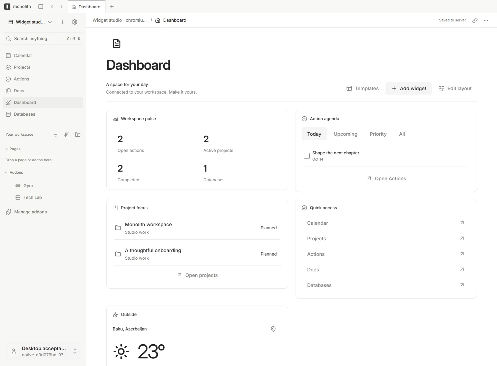
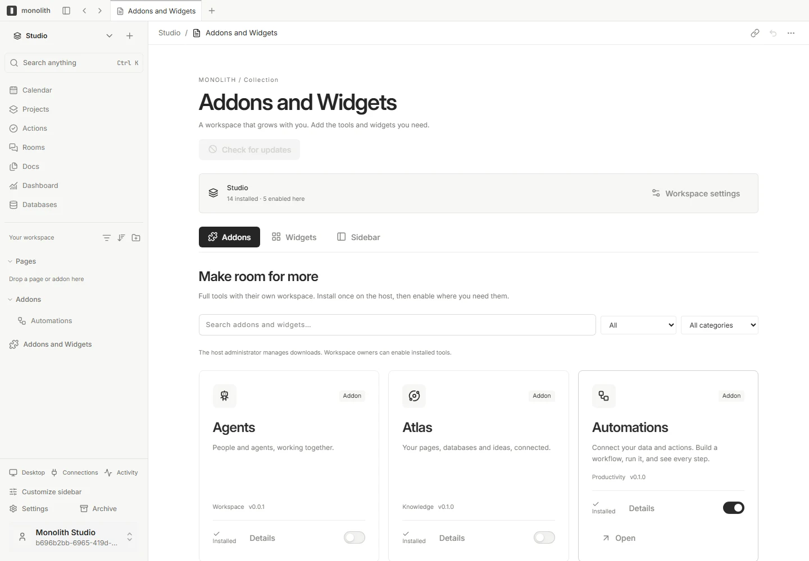

<div align="center">

<a href="https://monolith-site-maxjafars-projects.vercel.app">
  
</a>

# Monolith

**Make space for what matters.**

Your pages, projects and everyday tools in one self-hosted workspace.<br />Use the web, Windows or macOS. Connect your agents. Add the tools that fit your day.

[](https://github.com/MaxJafar/monolith/releases/tag/v0.1.16) [](https://monolith-site-maxjafars-projects.vercel.app/docs/self-hosting) [](https://monolith-site-maxjafars-projects.vercel.app/docs/agents)

**[Website](https://monolith-site-maxjafars-projects.vercel.app)** · **[Documentation](https://monolith-site-maxjafars-projects.vercel.app/docs)** · **[Quickstart](https://monolith-site-maxjafars-projects.vercel.app/docs/quickstart)** · **[Addons and Widgets](https://monolith-site-maxjafars-projects.vercel.app/addons)** · **[Releases](https://github.com/MaxJafar/monolith/releases)**

[Self-hosting](https://monolith-site-maxjafars-projects.vercel.app/docs/self-hosting) · [MCP and CLI](https://monolith-site-maxjafars-projects.vercel.app/docs/agents) · [Updates](https://monolith-site-maxjafars-projects.vercel.app/docs/updates) · [Contributing](#development)

</div>

<p align="center">
  
</p>

<p align="center"><sub>A connected workspace, shaped around your day. Screenshots use synthetic data.</sub></p>

---

## What is Monolith?

An idea becomes a page. A page becomes a project. Tasks need dates, records need context, and useful tools should be close to the work.

Monolith brings those pieces together. Write rich documents, organize structured information, plan projects and build a dashboard around what matters to you. Connected views use the same underlying records, so your calendar, project board and dashboard can show different perspectives on the same work.

Run it on your own infrastructure, connect browser and desktop clients, and extend it with optional addons, widgets and agent integrations.

## Keep your knowledge connected

- **[Docs and pages](https://monolith-site-maxjafars-projects.vercel.app/docs/pages)** — Nested pages, rich blocks, references, backlinks and inline database views.
- **[Databases](https://monolith-site-maxjafars-projects.vercel.app/docs/databases)** — Typed properties, relations, saved filters and table, board and calendar views.
- **[Atlas](https://monolith-site-maxjafars-projects.vercel.app/docs/atlas)** — An optional visual map for exploring connections between your knowledge.
- **[Search and navigation](https://monolith-site-maxjafars-projects.vercel.app/docs/workspace)** — Find accessible content and arrange your sidebar around your workspace.

## Turn plans into progress

- **[Projects](https://monolith-site-maxjafars-projects.vercel.app/docs/projects-calendar)** — Plan in boards, lists, timelines and Gantt views.
- **Actions** — Focus on Today, Upcoming, High priority and Completed.
- **[Calendar](https://monolith-site-maxjafars-projects.vercel.app/docs/projects-calendar)** — Bring dated records, events and subscriptions into month, week and agenda views.
- **[Rooms](https://monolith-site-maxjafars-projects.vercel.app/docs/rooms)** — Keep workspace conversations close to the work.
- **[Automations](https://monolith-site-maxjafars-projects.vercel.app/docs/automations)** — Connect workflow triggers and actions, then inspect execution history.

## Make your workspace your own

Start with eight native sections: **Calendar, Projects, Actions, Rooms, Docs, Journal, Dashboard and Databases**. Reorder navigation, choose light or dark appearance and add the tools you need.

| Layer           | What it brings                                   | Examples                                               |
| --------------- | ------------------------------------------------ | ------------------------------------------------------ |
| Native features | The shared workspace foundation                  | Pages, projects, calendar, databases                   |
| Addons          | Optional tools with their own workspace surfaces | Atlas, Automations, Agents, Redraw, Gym, Tech Lab      |
| Widgets         | Compact views with configuration overlays        | Calendar, Action agenda, Project focus, Training pulse |

**[Addons and Widgets](https://monolith-site-maxjafars-projects.vercel.app/addons)** separates installing a package on the host from enabling it in a workspace. Filter the shop by type, category and installation state; configure widgets in an overlay, add them to the dashboard or pin supported widgets to the sidebar.

<p align="center">
  
</p>

Configured hosts can use a signed GitHub Releases catalog for versioned downloads, progress, compatibility checks and package recovery. Packages can have independent versions while sharing a repository. The public website is a catalog; installation happens inside your Monolith host.

## Work with your agents

Connect **Codex, Claude Code, OpenClaw, Cursor** or another stdio MCP client to your workspace. Monolith’s MCP bridge and JSON CLI expose tools for pages, canonical documents, databases, records, projects, tasks and calendar events.

The bridge starts in read mode. Enable writes deliberately; your account permissions and document revision checks still apply. The separate **Agents addon** organizes worker-backed assignments and is not required to use MCP.

| Client                       | Configuration generator                        |
| ---------------------------- | ---------------------------------------------- |
| Codex                        | `pnpm --silent agent config --client codex`    |
| Claude Code / Claude Desktop | `pnpm --silent agent config --client claude`   |
| OpenClaw                     | `pnpm --silent agent config --client openclaw` |
| Cursor                       | `pnpm --silent agent config --client cursor`   |
| VS Code                      | `pnpm --silent agent config --client vscode`   |
| Other stdio MCP clients      | `pnpm --silent agent config --client generic`  |

Build and sign in before generating configuration. Follow the **[MCP and CLI guide](https://monolith-site-maxjafars-projects.vercel.app/docs/agents)** for authentication, permissions and client setup.

---

## Get started

- **Browser** — Run a local development workspace or connect to your configured host.
- **Desktop** — Download the [Windows x64 installer](https://github.com/MaxJafar/monolith/releases/download/v0.1.16/monolith-0.1.16-windows-amd64.exe) or [universal macOS disk image](https://github.com/MaxJafar/monolith/releases/download/v0.1.16/monolith-0.1.16-darwin-universal.dmg).
- **Self-host** — Download a Linux server image and the [setup kit](https://github.com/MaxJafar/monolith/releases/download/v0.1.16/monolith-0.1.16-server-kit.zip) from the [release](https://github.com/MaxJafar/monolith/releases/tag/v0.1.16), then follow the [installation guide](release/INSTALL.md).

> **[Download 0.1.16](https://github.com/MaxJafar/monolith/releases/tag/v0.1.16):** Windows, macOS, Linux x64/ARM64, six custom addon packages and the CLI/MCP bridge. This release keeps the desktop Updates button in the window corner and makes the Windows installer refresh taskbar icons. It includes the 0.1.15 fixes for dragging text on pages and saving pages with links, restricts sign-in provider changes to host administrators (`MONOLITH_AUTH_ADMIN_IDS`), blocks private-network remote requests and keeps large uploads from timing out. First-party Monolith code is licensed under **0BSD**. Automatic updates include authenticated downloads, progress and runtime rollback. Windows installers remain unsigned and macOS is not notarized. Servers on 0.1.14 or later update automatically; older servers need the 0.1.14 planned schema migration first. See [installation instructions](release/INSTALL.md), [updates](docs/UPDATES.md) and [checksums](https://github.com/MaxJafar/monolith/releases/download/v0.1.16/SHA256SUMS).

<details>
<summary><strong>Run the development workspace from source</strong></summary>

Use a checkout containing the matching Monolith implementation, **Node.js 22.23+**, **pnpm 11.21.0** and **PostgreSQL 17**. Set `POSTGRES_BIN` to your PostgreSQL bin directory when needed.

```sh
pnpm install --frozen-lockfile
pnpm build
pnpm local:setup
pnpm db:push
pnpm dev
```

Open **http://localhost:5173** and complete onboarding. The development API uses port **3636**; the isolated local database uses **55432**. `local:setup` creates ignored configuration and separate administrative and application database roles. `pnpm local:stop` stops the database while preserving its files.

Full setup and troubleshooting: **[Installation](https://monolith-site-maxjafars-projects.vercel.app/docs/installation)**.

</details>

### Your first workspace

1. **Capture an idea.** Create a page in Docs, give it a title and add the context you want to keep.
2. **Put work around it.** Create a project, add an action and give it a date. Explore the related project and calendar views.
3. **Shape your day.** Arrange the Dashboard, reorder the sidebar and preview a widget in Addons and Widgets.

Follow the **[first-workspace walkthrough](https://monolith-site-maxjafars-projects.vercel.app/docs/quickstart)** for the next steps.

## Updates and recovery

Windows, macOS and the single-host Docker server have a GitHub Releases update system with notifications, download progress, signed package verification and recovery to a previous runtime.

Automatic downloads and automatic installation are separate settings. Desktop updates respect saved-work checks; server installation uses a UTC maintenance window and health checks. Schema-changing releases require a planned migration: runtime rollback does not reverse database changes.

Automatic downloads and installation are enabled by default in updater-enabled clients. The hosted server requires the external supervisor. Update authentication uses Monolith’s release key independently of optional OS publisher signing. **[Read the update guide](https://monolith-site-maxjafars-projects.vercel.app/docs/updates).**

---

## Documentation

| I want to…                    | Start here                                                                                                                                                                                                                          |
| ----------------------------- | ----------------------------------------------------------------------------------------------------------------------------------------------------------------------------------------------------------------------------------- |
| Understand the product        | [Meet Monolith](https://monolith-site-maxjafars-projects.vercel.app/docs/introduction)                                                                                                                                              |
| Set up my first workspace     | [Installation](https://monolith-site-maxjafars-projects.vercel.app/docs/installation) · [Quickstart](https://monolith-site-maxjafars-projects.vercel.app/docs/quickstart)                                                           |
| Write and connect knowledge   | [Pages](https://monolith-site-maxjafars-projects.vercel.app/docs/pages) · [Databases](https://monolith-site-maxjafars-projects.vercel.app/docs/databases) · [Atlas](https://monolith-site-maxjafars-projects.vercel.app/docs/atlas) |
| Plan my day                   | [Projects and Calendar](https://monolith-site-maxjafars-projects.vercel.app/docs/projects-calendar) · [Widgets](https://monolith-site-maxjafars-projects.vercel.app/docs/widgets)                                                   |
| Extend the workspace          | [Addon installation](https://monolith-site-maxjafars-projects.vercel.app/docs/addons) · [Collection](https://monolith-site-maxjafars-projects.vercel.app/addons)                                                                    |
| Connect AI tools              | [MCP and CLI](https://monolith-site-maxjafars-projects.vercel.app/docs/agents) · [Agents addon](https://monolith-site-maxjafars-projects.vercel.app/docs/agents-addon)                                                              |
| Run and update a host         | [Self-hosting](https://monolith-site-maxjafars-projects.vercel.app/docs/self-hosting) · [Updates and recovery](https://monolith-site-maxjafars-projects.vercel.app/docs/updates)                                                    |
| Understand the implementation | [Architecture](https://monolith-site-maxjafars-projects.vercel.app/docs/architecture) · [Development](https://monolith-site-maxjafars-projects.vercel.app/docs/development)                                                         |
| Resolve a problem             | [Troubleshooting](https://monolith-site-maxjafars-projects.vercel.app/docs/troubleshooting) · [FAQ](https://monolith-site-maxjafars-projects.vercel.app/docs/faq)                                                                   |

The workspace maintains English, Malay, Simplified Chinese and Traditional Chinese locale packs. The public docs are currently in English.

## Architecture

```text
 Browser          Windows / macOS          Agent clients
    |                    |                       |
    |                    |                 MCP / JSON CLI
    +--------------------+-----------------------+
                         | HTTPS
                   Monolith gateway
                    /            \
          Canonical documents   Domain API
                    \            /
                     PostgreSQL
```

| Layer           | Implementation                                                            |
| --------------- | ------------------------------------------------------------------------- |
| Workspace       | React 19, shared Monolith UI and API contracts                            |
| Documents       | BlockSuite and Yjs, persisted through revision-checked gateway operations |
| Windows         | Tauri and WebView2                                                        |
| macOS           | AppKit and WKWebView                                                      |
| Host            | Public Go gateway and private TypeScript domain API                       |
| Storage         | PostgreSQL 17 and persistent uploaded files                               |
| Extensions      | Independently versioned addons and registered widgets                     |
| Product website | Static Astro site deployed to Vercel                                      |

See **[Architecture](https://monolith-site-maxjafars-projects.vercel.app/docs/architecture)** for repository paths and the boundaries between clients, host services and optional workers.

## Development

Use the pinned pnpm version and follow the [development guide](https://monolith-site-maxjafars-projects.vercel.app/docs/development). Run checks appropriate to your change:

```sh
pnpm core:check
pnpm typecheck
pnpm build
pnpm gateway:test
pnpm agent:test
```

Native packaging requires the matching platform. OS signing credentials are optional in the explicit unsigned installer mode; update manifests still require the release key. The public website has its own build and checks:

```sh
pnpm site:build
pnpm site:check
pnpm site:test
```

For contributions, describe the problem in a [GitHub issue](https://github.com/MaxJafar/monolith/issues), make a focused change and include relevant validation. Keep addon secrets on the host and user data outside replaceable application packages.

<details>
<summary><strong>Create and release an addon</strong></summary>

```sh
pnpm monolith addons create yourname--reading-list
pnpm install
pnpm --filter @monolith/yourname--reading-list build
pnpm release:addons yourname--reading-list
```

Each addon has a manifest, an independent version and four locale files. Runtime releases contain compiled files and a checksum-verified manifest. Source-sharing tarballs are produced separately with `pnpm monolith addons pack yourname--reading-list`.

Addons execute trusted application code; they are not sandboxed. See [addon installation](https://monolith-site-maxjafars-projects.vercel.app/docs/addons) and [development and releases](https://monolith-site-maxjafars-projects.vercel.app/docs/development) for compatibility, signing and migration requirements.

</details>

---

## License and attribution

Monolith’s first-party code is open source under the [Zero-Clause BSD license (0BSD)](LICENSE). You can use, modify and redistribute it, including commercially. Maintained by **Monolith contributors**.

Third-party components retain their own licenses. See [third-party notices](THIRD_PARTY_NOTICES.md), [source provenance](legal/source-provenance.json), and [source and license information](https://monolith-site-maxjafars-projects.vercel.app/docs/availability#source-and-licenses).

BlockSuite, Yjs and other dependencies retain their own notices. The Monolith mark and cover are original project assets.
