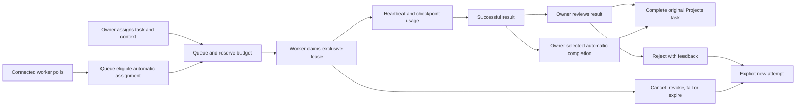

# Multica / Paperclip REA and ZillionOS agent integration

ZillionOS now has an [Agents workspace](http://localhost:5173/agents): humans and agents are assignable principals on the existing Projects tasks. Project grants, reporting lines, dependencies, linked knowledge, budget reservations, durable runs and human review use PostgreSQL. The implementation is native to the existing Forge/React/Drizzle stack.

## Sources and evidence

Research was performed on 12 October 2026 against pinned checkouts. No upstream application was started, and this report does not claim behavioral equivalence.

| Source                                                                                              | Pinned revision                            | REA analysis scope                                | Static graph                                                                      |
| --------------------------------------------------------------------------------------------------- | ------------------------------------------ | ------------------------------------------------- | --------------------------------------------------------------------------------- |
| [Multica](https://github.com/multica-ai/multica/tree/b115ec80f1748d8d2766481706b0ecb830389286)      | `b115ec80f1748d8d2766481706b0ecb830389286` | `packages/core`, its TypeScript client/data layer | 512 parsed files, 2,109 nodes, 3,321 edges; partial coverage                      |
| [Paperclip](https://github.com/paperclipai/paperclip/tree/f5346c05b923a1eb1d15d04d8e08b993a7c4d097) | `f5346c05b923a1eb1d15d04d8e08b993a7c4d097` | `server/src`                                      | 2,090 parsed files, 6,608 nodes, 6,906 edges; partial coverage, one parse failure |

The actual `rea-agents@6.4.0` CLI was run through pnpm, from `/tmp` to avoid this repository's install hooks:

```sh
pnpm dlx rea-agents@6.4.0 analyze-javascript-application /Users/maksud555/Desktop/LifeForgePersonal/.temp/multica-research/packages/core --format json
pnpm dlx rea-agents@6.4.0 analyze-javascript-application /Users/maksud555/Desktop/LifeForgePersonal/.temp/paperclip-research/server/src --format json
```

Raw evidence remains in ignored `.temp/multica-agent-evidence.json` and `.temp/paperclip-agent-evidence.json`. [The compact evidence record](ZILLION-AGENTS-REA.json) preserves revisions, subject digests, evidence IDs, graph counts and coverage limits. REA parsed inert source and recovered static module/binding relationships; resource limits prevented complete semantic expansion. Multica's Go server is outside the JavaScript analysis. SQL migrations/queries and Paperclip schema/services were also inspected manually. The architectural mapping below is an inference from those source observations, verified separately against Zillion's own implementation.

## What transferred from each system

| Source observation                                                                                                                                                                                                                                                                                                                                                                                                                                                                                                                                                                                                                                                 | ZillionOS implementation                                                                                                                                                                                                                                |
| ------------------------------------------------------------------------------------------------------------------------------------------------------------------------------------------------------------------------------------------------------------------------------------------------------------------------------------------------------------------------------------------------------------------------------------------------------------------------------------------------------------------------------------------------------------------------------------------------------------------------------------------------------------------ | ------------------------------------------------------------------------------------------------------------------------------------------------------------------------------------------------------------------------------------------------------- |
| Multica's [initial schema](https://github.com/multica-ai/multica/blob/b115ec80f1748d8d2766481706b0ecb830389286/server/migrations/001_init.up.sql) distinguishes human members from agents and allows either kind of issue assignee. Its issues carry parent/context/acceptance metadata.                                                                                                                                                                                                                                                                                                                                                                           | One owner principal and multiple agent principals; an assignment references either kind. Task briefs, dependencies and explicit document/record/note context use the existing task/page identities.                                                     |
| Multica's [agent queue queries](https://github.com/multica-ai/multica/blob/b115ec80f1748d8d2766481706b0ecb830389286/server/pkg/db/queries/agent.sql) use persisted queues, runtime-health checks, prepare leases and `FOR UPDATE SKIP LOCKED` claims. They serialize execution for an issue/agent pair.                                                                                                                                                                                                                                                                                                                                                            | Persisted runs, exclusive claims, credential-bound heartbeats, expiry and explicit retries. Zillion permits one active run per task and uses a coarser owner transaction lock; it does not reproduce Multica's multi-agent execution of the same issue. |
| Paperclip's [agent schema](https://github.com/paperclipai/paperclip/blob/f5346c05b923a1eb1d15d04d8e08b993a7c4d097/packages/db/src/schema/agents.ts) combines company scope, reporting lines, lifecycle, adapters, permissions and monthly budgets.                                                                                                                                                                                                                                                                                                                                                                                                                 | Owner scope, acyclic reporting lines, lead/contributor/observer roles, active/paused lifecycle, local/external adapters and UTC-month budgets. Reporting lines organize agents without adding authority.                                                |
| Paperclip's [issue schema](https://github.com/paperclipai/paperclip/blob/f5346c05b923a1eb1d15d04d8e08b993a7c4d097/packages/db/src/schema/issues.ts) distinguishes agent/user assignees and tracks checkout/execution runs. Its [issue service](https://github.com/paperclipai/paperclip/blob/f5346c05b923a1eb1d15d04d8e08b993a7c4d097/server/src/services/issues.ts) checks scope and concurrent execution.                                                                                                                                                                                                                                                        | Shared native Projects tasks, revision checks, task snapshots and stale-result rejection. Human approval completes that original task, so the two boards stay connected.                                                                                |
| Paperclip's [hashed agent keys](https://github.com/paperclipai/paperclip/blob/f5346c05b923a1eb1d15d04d8e08b993a7c4d097/packages/db/src/schema/agent_api_keys.ts), [agent authentication](https://github.com/paperclipai/paperclip/blob/f5346c05b923a1eb1d15d04d8e08b993a7c4d097/server/src/middleware/auth.ts), [heartbeat runs](https://github.com/paperclipai/paperclip/blob/f5346c05b923a1eb1d15d04d8e08b993a7c4d097/packages/db/src/schema/heartbeat_runs.ts) and [approvals](https://github.com/paperclipai/paperclip/blob/f5346c05b923a1eb1d15d04d8e08b993a7c4d097/packages/db/src/schema/approvals.ts) separate machine identity, execution and governance. | Expiring/revocable hashed machine credentials, authenticated activity, leases, reported costs and owner-only review. Agents have no human JWT or browser session.                                                                                       |

Zillion keeps its existing personal-account ownership model. It has not imported either upstream's server, UI, company/workspace model, SDK or adapter plugins.

## Data relationships and permissions

Nine tables have the `zillion_agents__` prefix and forced owner policies:

| Table           | Relationship and purpose                                                                                                                                            |
| --------------- | ------------------------------------------------------------------------------------------------------------------------------------------------------------------- |
| `principals`    | One human owner and agent profiles; reporting-line self-FK, role, lifecycle, runtime, instructions, monthly budget and revision.                                    |
| `members`       | Unique principal/project grant referencing native `projects__entries`.                                                                                              |
| `assignments`   | Unique native `projects__tasks` assignment; assignee, state, priority, revision and per-task automatic dispatch/completion choices.                                 |
| `dependencies`  | Same-project task/blocker edges; no self-reference or cycles.                                                                                                       |
| `context_links` | Exactly one document, record or note FK per selected context page; page deletion removes its context edge.                                                          |
| `credentials`   | Hashed, expiring, revocable machine credentials and last-use metadata.                                                                                              |
| `runs`          | Immutable task/context/instruction/runtime/policy snapshots, reservation, lease, output and decision. Owner-unique dispatch keys and one active run per task.       |
| `usage_records` | Durable per-run token/cost ledger. Original run identity is unique; deleting a task/run retains its title, runtime, status, counts and cost with a nullable run FK. |
| `activity`      | Authenticated actor and task/run references; task deletion retains activity with nullable references.                                                               |

Foreign keys enforce existence and deletion relationships. API checks enforce ownership and project roles; forced RLS scopes every authenticated transaction. Owner advisory locks serialize reporting graphs, budgets, claims and revocations. Native task row locks protect against concurrent Projects edits. Schema changes use the administrative role; runtime uses `zillion_app`, which is neither superuser nor BYPASSRLS. Schema push validates changed same-name CHECK constraints atomically, and backfills historical cost-only runs before task deletion can remove them.

The real account remains the human owner. Lead/contributor agents execute their own assignments only in projects granting lead/contributor access. Observers cannot execute. Reporting lines organize the team without expanding authority. Machine credentials are restricted to seven runtime endpoints; they cannot access human management routes, unrelated modules, files or stored provider keys. Agents are assignable workspace principals, rather than extra interactive login accounts. Additional human invitations and shared account workspaces are not implemented.

## Run lifecycle and automation



Dispatch requires a current assignment revision, unfinished task, project grant, completed blockers and available monthly budget. UUID request keys make retries idempotent. A run freezes the title, task version, instructions, adapter and completion policy. Only explicitly selected pages enter its context: at most 40 pages and 20,000 characters per page. Task changes or deleted context invalidate execution/review; edits to an existing context page do not silently rewrite an already dispatched snapshot.

In **Task automation**, the owner can save automatic dispatch, a per-run limit and optional automatic completion. A connected non-planner worker's inbox check queues one eligible ready assignment. Priority ordering skips blocked/unaffordable candidates rather than starving eligible work. Concurrent polls cannot create duplicate active runs. Successful automatic completion updates the same native Projects task; otherwise results require owner review. Failures stay blocked for explicit retry. These choices apply to the selected task. There is no separate always-on server scheduler; the worker must remain running.

Claims receive a random lease with a two-minute expiry bound to the claiming credential. Workers renew every 30 seconds and can checkpoint cumulative usage. Pause, cancellation, access removal, revocation and expiry invalidate execution. Reconciliation occurs on workspace/runtime requests. A late result cannot resurrect cancelled or expired work. Opening a run from usage history resolves its owned identity even beyond the 200 most recent workspace runs.

## Tokens, costs and history

**Usage & tokens** shows provider/model/session, input, cached input, output, total, recorded cost, state and immutable task title. Agent/month filters and pagination use whole-filter aggregates; the month filter refers to run creation. Cached counts are included in input, and total equals input plus output. Missing historical counts remain unknown, with visible coverage rather than invented zeros. Task deletion retains usage. Historical records with no runtime evidence do not pretend to identify their original runtime.

Token checkpoints are cumulative and must not decrease or switch provider/model/session. The ledger persists known usage before successful completion, failure or cancellation. Reservations count only the remaining uncharged portion; counted usage is not double-charged. Reservations survive month boundaries; recorded charges count toward the UTC month of their first charge. Cancellation releases unreported reservations while retaining known costs. The database rejects partial-null or inconsistent token tuples.

Costs are USD-cent estimates calculated from owner-supplied rates, not provider invoices or provider-side spending caps. Cached-input rates are separate. Codex terminal events replace cumulative counts rather than summing duplicates. OpenClaw reports uncached input, cache reads and cache writes separately: Zillion adds all three to input, classifies cache reads as cached input and prices cache writes at the uncached input rate. Actual reported model/session identifiers are retained when available.

If a worker reports a cost over its reservation, execution fails, the reservation is charged, and the larger reported estimate is retained visibly for reconciliation. CLI token consumption can precede reporting; a killed process or a provider response with no usage cannot supply complete accounting. Owner reconciliation is still required in those cases.

## Connecting workers

1. In **People & agents**, choose a runtime, instructions, role and monthly budget. Available runtimes are **Workspace planner**, **External AI worker**, **Custom CLI agent**, **Codex CLI** and **OpenClaw agent**.
2. Grant project contributor access, choose a native task and assignee, select knowledge pages and save. Dispatch explicitly, or save the per-task automation choices.
3. For a non-planner runtime, issue an expiring scoped credential and place its once-visible value in a private regular file, mode `0600`, outside Git. The UI issues seven-day credentials; API clients support 1–30 days.
4. Configure the installed runtime's own authentication, an exact model identifier and current rates in **USD cents per million tokens**. Supply an absolute working directory for process adapters. Keep credential values out of command arguments.

Use the following common arguments, adding one adapter's arguments below. Environment variables in this example are owner-supplied configuration, not guessed rates:

```sh
pnpm agents:worker \
  --server http://localhost:3636 \
  --token-file /absolute/path/to/private-agent-token \
  --adapter codex \
  --cwd /absolute/path/to/assigned-workspace \
  --model "$ZILLION_AGENT_MODEL" \
  --input-cents-per-million "$ZILLION_AGENT_INPUT_CENTS" \
  --cached-input-cents-per-million "$ZILLION_AGENT_CACHED_CENTS" \
  --output-cents-per-million "$ZILLION_AGENT_OUTPUT_CENTS" \
  --timeout-seconds 600
```

| Adapter    | Configuration and behavior                                                                                                                                                                                                                                              |
| ---------- | ----------------------------------------------------------------------------------------------------------------------------------------------------------------------------------------------------------------------------------------------------------------------- |
| `external` | Requires `OPENAI_API_KEY`. OpenAI Responses SDK, written output, no tools, `store: false`, no automatic retries, conservative input/output cost preflight. `--max-output-tokens` defaults to 2048.                                                                      |
| `codex`    | Requires an authenticated installed `codex` on PATH. Runs `codex exec --json` with stdin, explicit model/CWD and `--sandbox read-only` by default. The owner may explicitly select `--sandbox workspace-write`. No bypass-sandbox flag is used.                         |
| `openclaw` | Requires configured OpenClaw/Gateway and `--openclaw-agent <id>`. Uses `agent --json`, a private task file, explicit model and unique `zillion:<run UUID>` session key. It never supplies `--deliver`. The configured OpenClaw agent controls its own tool permissions. |
| `cli`      | Requires `--command /absolute/path/to/trusted-executable --args-json '[]'`. Receives a JSON task on stdin and returns the JSON protocol below. Arguments are passed as an array with `shell: false`.                                                                    |
| `planner`  | Runs inside Zillion as a deterministic brief/context/checklist at zero provider cost. It does not invoke a model or execute the checklist; no portable worker is needed.                                                                                                |

`--once` performs one inbox check; otherwise the worker polls every ten seconds. Process timeouts support 1–3600 seconds. Output is bounded, abort/timeout stops the process group, and temporary task files are cleaned up. Child environment forwarding is restricted; the Zillion credential and database configuration are not passed into agent processes. The registered runtime must match `--adapter`. Remote Zillion origins require HTTPS; HTTP is limited to loopback development.

The worker delegates execution to the owner's configured local runtime. Codex/OpenClaw/custom CLI tools can operate within that runtime's permissions; a successful result optionally completes the assigned Projects task. Zillion machine credentials do not automatically gain mutation access to Wallet, Calendar, Todo or every other life module. Recursive agent delegation and a general cross-module action API are not implemented.

### Custom CLI result

Stdin is `{run_id, budget_cents, instructions, task: {title, content}, context: [{key, title, content}]}`. Stdout must be a JSON object, with no prefixed log text:

```json
{
  "result": "Result and evidence for the assigned task",
  "provider": "your-runtime",
  "model": "actual-model-id",
  "session_id": "actual-session-id",
  "usage": {
    "input_tokens": 1250,
    "cached_input_tokens": 800,
    "output_tokens": 400
  }
}
```

Rates determine cost; input includes the cached portion. Missing/invalid counts fail instead of becoming zero. Diagnostics may go to stderr. A nonzero exit retains any valid reported usage. No live provider or owner CLI session was run during verification.

## Scoped runtime protocol

Stable base path: `/modules/zillion--agents/runtime/`, authenticated with `Authorization: Bearer <agent credential>`:

| Method | Endpoint                  | Behavior                                                                        |
| ------ | ------------------------- | ------------------------------------------------------------------------------- |
| GET    | `me`                      | Own principal, project grants and budget usage.                                 |
| GET    | `inbox`                   | Own queued work; also queues one eligible automatic assignment.                 |
| POST   | `claim?id=<run UUID>`     | Task/context/instructions, frozen adapter/policy and once-issued lease.         |
| POST   | `heartbeat?id=<run UUID>` | `{lease, usage?}`; renew lease and optionally persist cumulative usage.         |
| POST   | `comment?id=<run UUID>`   | `{lease, message}`; append progress.                                            |
| POST   | `complete?id=<run UUID>`  | `{lease, result, cost_cents, usage?}`; review or selected automatic completion. |
| POST   | `fail?id=<run UUID>`      | `{lease, error, cost_cents, usage?}`; retain known cost and block for retry.    |

Optional usage is `{provider, model, session_id, input_tokens, cached_input_tokens, output_tokens, total_tokens, reported_cost_cents}`. Counts are validated integers; cached input cannot exceed input, and total must equal input plus output. Responses use `{state: "success", data: …}`; successful comment/complete/fail return HTTP 204. Runtime endpoints use HTTPS transport rather than browser AES envelopes. Machine authentication rejects hashed browser routes and all owner management/history endpoints.

## Verification and limits

The [verification report](ZILLION-VERIFICATION.md) records build/type checks, all local tests and browser proof. Twenty-eight agent integration tests cover ownership/RLS, roles/grants, graph/revision races, budget contention, idempotency, exclusive leases, stale context/tasks, review, immutable history links, durable cancellation/deletion accounting and automatic dispatch without priority starvation. Eight adapter tests use real fake executable processes for JSON stdin, Codex JSONL, OpenClaw task files, credential isolation, timeout/abort, partial failures and duplicate token reports. Installed CLI help and OpenClaw usage-normalization source were inspected alongside [Codex's CLI reference](https://developers.openai.com/codex/cli/reference) and [OpenClaw's agent documentation](https://docs.openclaw.ai/cli/agent).

A temporary synthetic CLI credential drove the running API's installed router through inbox, automatic dispatch, claim, token checkpoint and successful automatic completion. The original Projects task became Done and usage history showed 1,650 tokens (1,250 input, 800 cached, 400 output) and a 14-cent estimate. The credential was revoked after verification. No live provider request, real account agent session, production data or deployment was used.

The surrounding life workspace combines nested document libraries (Outline-inspired), typed blocks and database properties/views/relations (AFFiNE-inspired), stable links/backlinks and a visual knowledge map (Obsidian-inspired), agent assignees and runtime adapters (Multica-inspired), and roles/budgets/leases/review (Paperclip-inspired). These are independent implementations of selected concepts. They do not establish full upstream parity, CRDT/collaboration, offline sync, vault/plugin compatibility, shared company accounts or provider invoice reconciliation.

## Licenses

[Paperclip's pinned license](https://github.com/paperclipai/paperclip/blob/f5346c05b923a1eb1d15d04d8e08b993a7c4d097/LICENSE) is MIT. [Multica's pinned license](https://github.com/multica-ai/multica/blob/b115ec80f1748d8d2766481706b0ecb830389286/LICENSE) is the **Multica License**, combining Apache 2.0 text with additional hosted/embedded use and branding/attribution conditions; it is not plain Apache 2.0. Its [NOTICE](https://github.com/multica-ai/multica/blob/b115ec80f1748d8d2766481706b0ecb830389286/NOTICE) identifies Index Labs (Hong Kong) Limited. REA-authored code is MIT; its analysis providers retain their own terms.

No Multica/Paperclip implementation or visual assets were copied, bundled or vendored. Zillion's code implements the observed architectural concepts independently. The LifeForge fork's existing license and attribution remain in place.
