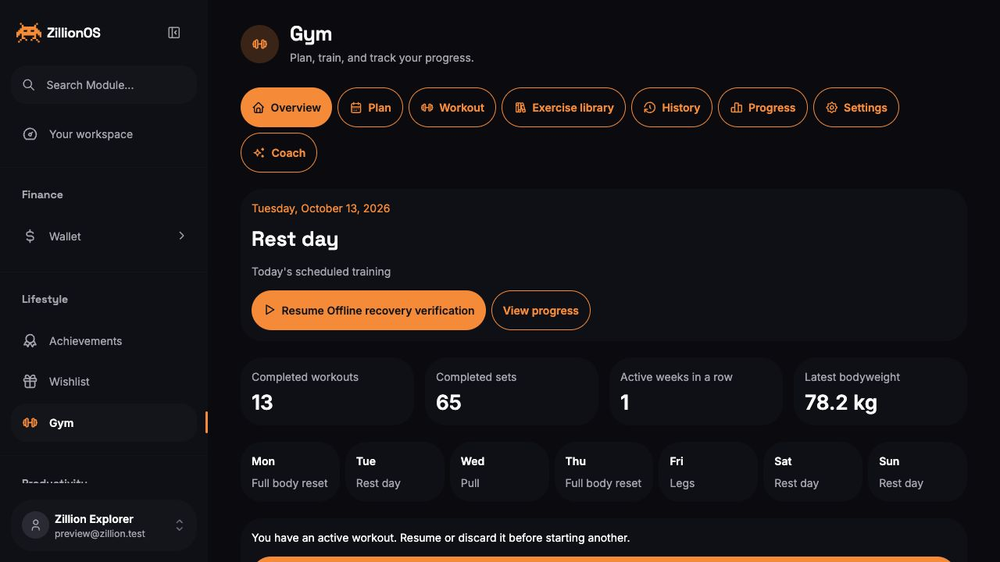
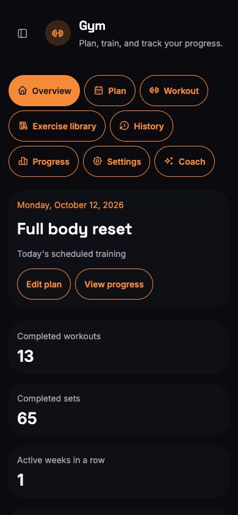
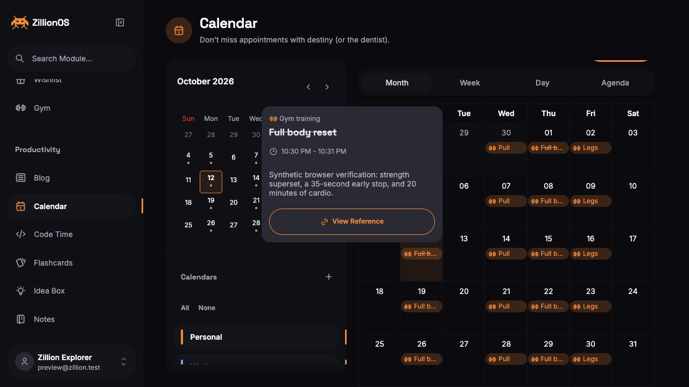
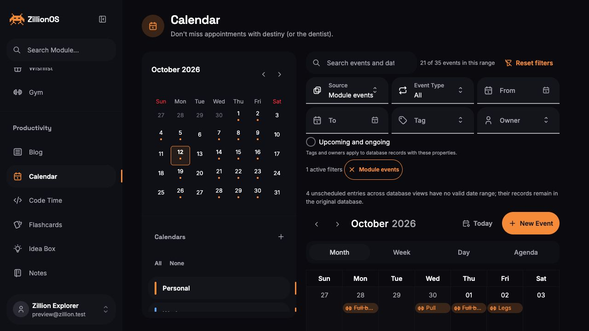
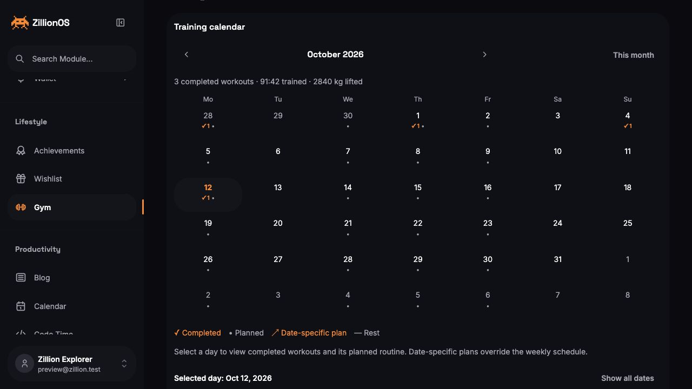
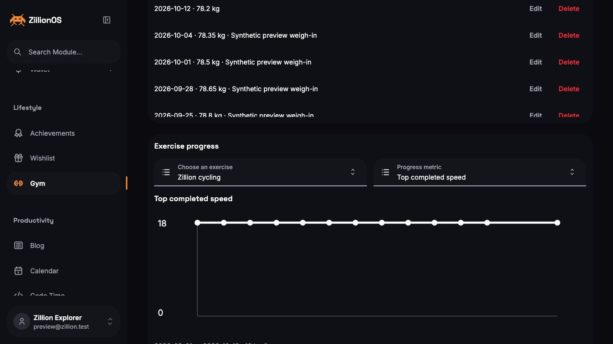
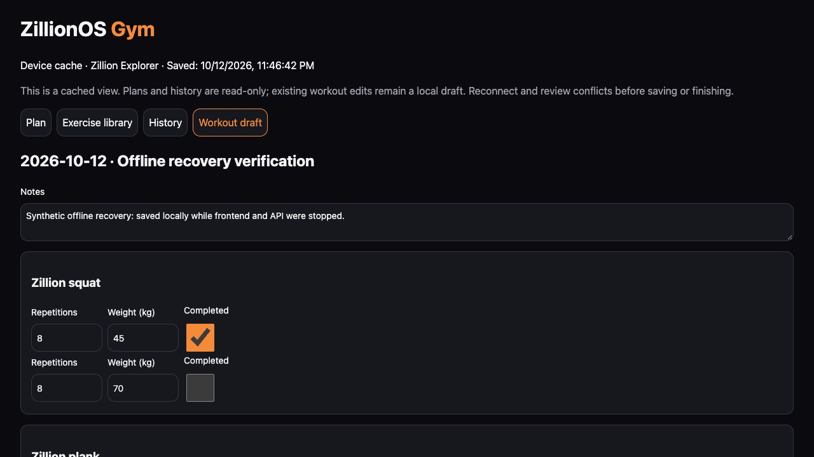

# Native ZillionOS Gym integration

Verified on 2026-10-12, with final checks on 2026-10-13, against the isolated local development database at `127.0.0.1:55432/zillion_dev`. The browser preview is [Gym](http://localhost:5173/gym). This is a native module of the existing monolith; it uses ZillionOS authentication, UI, PostgreSQL, Calendar and Agents.

The source inventory and actual REA execution are recorded in [OpenGym research](ZILLION-GYM-RESEARCH.md) and [REA evidence](ZILLION-GYM-REA.json). OpenGym was pinned to `678bf5bf10446e8997a77d43e89c9b2721d8d0fc`. REA reported partial frontend semantic coverage and unknown API semantic completeness, so its graphs were supplemented with manual source review and native tests. The upstream application and providers were never executed.

## Implemented behavior

| Area                    | Native implementation                                                                                                                                                                                                                                                                                                                                                                                                             |
| ----------------------- | --------------------------------------------------------------------------------------------------------------------------------------------------------------------------------------------------------------------------------------------------------------------------------------------------------------------------------------------------------------------------------------------------------------------------------- |
| Navigation and identity | Gym under Lifestyle at `/gym`; eight URL-driven sections; existing ZillionOS account, dark/orange appearance and four languages.                                                                                                                                                                                                                                                                                                  |
| Exercises               | 1,324 attributed non-media catalog entries, search/filter/detail/instructions, owned custom exercises, archive handling, primary and secondary muscles. English and Chinese instruction data.                                                                                                                                                                                                                                     |
| Plans                   | Ordered routine entries, strength/timed/cardio prescriptions, adjacent supersets, overrides and progression policies, duplicate/archive, deterministic Push/Pull/Legs seed, weekly assignments and civil-date overrides including explicit rest.                                                                                                                                                                                  |
| Training                | Routine or freestyle start, atomic daily weigh-in, one active session per owner, immutable historical exercise/target snapshots, completed sets, RIR/RPE, working-load confirmation, group navigation and automatic advance.                                                                                                                                                                                                      |
| Timers and recovery     | Persisted work/rest timers, early-stop elapsed seconds, reload/resume, sound and wake-lock capability feedback. Owner-scoped local workout drafts and exact update-command replay after connection loss; timed commands and finishing require server acknowledgement.                                                                                                                                                             |
| Completion/history      | Saved-session summary with duration, completed sets, volume, strength records and muscle coverage; search/status/date filters; Monday-first monthly history grid with planned/rest/rescheduled/completed days and native detail links; corrected history and derived statistics; discarded history retained; revision-safe edits.                                                                                                 |
| Progress                | Week goal/current streak and heatmap; shared preset/custom date ranges; primary/secondary muscle coverage; normalized RIR/RPE effort coverage, histogram and weekly/exercise curves; strength load/volume/estimated-1RM, timed duration and cardio speed/time/distance trends; Epley/Brzycki/Lombardi calculator; ranged bodyweight/goal/delta. Canonical kg/km/h prevent unit relabeling.                                        |
| Data portability        | Reviewed native/OpenGym JSON, shared plans, FitNotes Android/iOS, Strong/Hevy CSV and Apple Health body-mass XML; unambiguous name matching, custom fallback, per-record units, explicit ambiguous-date choices and source timezone, DST validation, session deduplication, atomic merge/replacement. Full backup, private-data-free plan export and plan print sheet.                                                            |
| Calendar                | `_gym` source in the existing dedicated Calendar; planned workouts use the configured timezone/reminder time; completed sessions use actual start/end instants; rest overrides and completed-workout suppression; links open the corresponding native plan/history.                                                                                                                                                               |
| Reminders               | Explicit opt-in foreground reminders and background Web Push for planned workouts, rest timers and valid Coach proposals; owned subscriptions, per-category preferences, test queue, delivery status, VAPID encryption, durable deduplication/retry/expiry and logout gating. Timer sound/wake lock are capability dependent.                                                                                                     |
| Offline access          | Explicit single-profile cache with a dedicated service-worker Gym shell: plan, schedule, searchable catalog/instructions and history remain readable after a cold navigation. Existing active-session edits use a separate owner-scoped outbox, baseline checks and reconnect reconciliation. The approved Gym snapshot is stored locally; credentials and authenticated HTTP responses are excluded from service-worker caching. |
| Coaching                | Existing CLI/Codex/OpenClaw/external workers; explicit intake/consent and worker requirement; bounded task context, reservations, existing token/usage ledger, manual/refined/weekly/session reviews, strict proposals, selected atomic application, stale-plan protection, cancellation and guarded plan-only revert.                                                                                                            |

## Relationships and concurrency

The schema has ten core tables (`exercises`, `routines`, `routine_entries`, `schedule`, `workouts`, `workout_entries`, `workout_sets`, `bodyweight`, `settings`, `commands`), three coaching tables (`coach_configs`, `coach_jobs`, `coach_snapshots`) and two push tables (`push_subscriptions`, `push_deliveries`). All fifteen use PostgreSQL RLS and `FORCE ROW LEVEL SECURITY`. The verified application role has neither superuser nor RLS-bypass privileges. Core child references validate the owner as well as the record ID; imported identities are remapped.

Workout commands use an owner-scoped idempotency key, payload check, expected revision and transaction. A replay cannot repeat a finish, rewind a subsequent weigh-in, or apply different input under the same command ID. Starting a workout and upserting its check-in are atomic. Rest/work targets and historical labels survive later catalog/routine edits. Replacement restores edited/archived built-in metadata with monotonically increasing revisions; merge keeps current catalog edits.

Coaching locks Agents before Gym, uses the existing leased worker API and reserves the configured budget. Referenced plan exercises are included before filling the 200-item candidate limit; oversized referenced plans fail explicitly. Proposals consolidate each routine mutation and weekday assignment, so individually selected changes cannot conflict through repeated revisions. Plan hashes and row revisions protect application/revert. Session cadence uses completion timestamps after the durable review boundary, so deleting the previous history anchor does not recount old training. Scheduled reviews run when the selected authenticated worker polls; a budget conflict rolls back Gym dispatch without hiding its existing inbox work.

Gym reset/replacement preserves command, coaching and Agents audit records. Previously queued task contexts and plan snapshots are retained as audit data; reset is not a promise to erase historical agent payloads. Existing proposals become stale when the plan changes.

Offline caching is an explicit choice for this browser. Sign-out clears the full profile cache and disables the worker; an already-open cached tab locks when ownership is removed or changed. Owner-scoped recovery records remain available only when that same owner returns. Offline edits never overwrite the native pending-command record: they retain its exact baseline and use a separate outbox. A newer native draft, changed active session or another tab's edit produces a conflict instead of silent replacement. Starting or finishing a session and timer command acknowledgement require reconnection.

Push mutations require a human session. The dispatcher uses bounded owner batches, fair delivery budgets, persisted leases and strict HTTPS/public-address validation; private/local/metadata destinations, redirects and DNS rebinding are rejected. Encrypted payloads include the owner ID, which must match a positively established service-worker owner gate before display. Logout disables notification display, closes visible notifications and unsubscribes the browser; packets already dispatched cannot be recalled. Planned reminders expire after fifteen minutes, and rest reminders five minutes after their deadline, so prolonged API downtime can miss them. Tests use controlled sender/DNS fixtures; no external push endpoint was contacted.

For production Web Push, configure `ZILLION_GYM_PUSH_PUBLIC_KEY`, `ZILLION_GYM_PUSH_PRIVATE_KEY` and `ZILLION_GYM_PUSH_SUBJECT`. Use HTTPS, a supporting browser, explicit notification permission and a running API dispatcher. Missing keys are represented as an unavailable capability. Live delivery still depends on the browser/OS and push service.

## Verification results

| Check                        | Result                                                                                                                                                                                                                                                                                                                             |
| ---------------------------- | ---------------------------------------------------------------------------------------------------------------------------------------------------------------------------------------------------------------------------------------------------------------------------------------------------------------------------------- |
| `pnpm build`                 | 30/30 workspace build tasks passed.                                                                                                                                                                                                                                                                                                |
| `pnpm typecheck`             | 26/26 workspace typecheck tasks passed.                                                                                                                                                                                                                                                                                            |
| Gym package tests            | 262/262 passed across sixteen files covering model, catalog, coaching, imports, recovery, timers, analytics/history, notifications, service workers, push transport, offline cache/outbox behavior and cross-account query isolation.                                                                                              |
| Native PostgreSQL Gym suites | 48/48 passed: core persistence/ownership/commands/imports (16), leased coaching/budgets/apply/revert/cadence/proposal notifications (14), Calendar actual timestamps/DST/overlap/rest/ownership (6), owned push subscriptions/deduplication/leases/retry/expiry/fairness (12).                                                     |
| Combined Gym coverage        | 310/310 package and PostgreSQL tests passed.                                                                                                                                                                                                                                                                                       |
| Production build regressions | 24/24 targeted resolver and server-entry tests passed. Public dependency export maps are preserved and module Calendar feeds are emitted as compiled event entries.                                                                                                                                                                |
| Compiled API smoke test      | Production startup loaded all fifteen modules and registered 385 routes. Authenticated Gym snapshot/push status and the shared Calendar event-range request returned 200; the Calendar displayed native Gym events.                                                                                                                |
| Scoped ESLint                | Gym and touched Calendar/Agents/test files passed. Generated contract size produces a Babel informational message.                                                                                                                                                                                                                 |
| Scoped Prettier              | All matched module/integration/research files passed.                                                                                                                                                                                                                                                                              |
| Local schema push            | Passed (92 statements); subsequent catalog inspection confirmed all fifteen forced-RLS tables under the application role.                                                                                                                                                                                                          |
| Locale consistency           | 496 matching nonempty string keys and 46 matching interpolated strings across English, Malay, simplified and traditional Chinese.                                                                                                                                                                                                  |
| Broader API suite            | 210 passed, 18 failed in the four existing authentication test files. These tests expect raw 400/401 response objects while the current API client rejects those errors. Login, refresh rejection and authenticated Gym access were also exercised through the browser. These older failures were not changed in this module task. |

The browser used synthetic data in `preview@zillion.test`, never a live fitness profile. It started a mixed-mode superset with a 78.2 kg check-in, saved two strength sets, reloaded a running work timer, stopped it at 35 seconds, completed the timed partner and 20-minute cardio set, and finished with five saved sets and 1,040 kg strength volume. History editing persisted a synthetic verification note. Progress showed thirteen sessions, sixty-five sets, 9,440 kg total volume and the new check-in. Disabled coaching intake saved multi-value equipment without granting agent access. Desktop/mobile and Calendar checks are captured below.

At a 390 × 844 phone breakpoint, Overview, Plan, exercise search/detail and Progress had no page-width overflow or missing locale labels. The weekly selectors displayed explicit rest days. Plan export downloaded four routines with empty workout/weigh-in arrays and no settings. The shared Calendar's module filter displayed 21 of 35 local events; its completed Gym event showed the actual session time and its reference opened the exact saved history record. The temporary viewport was reset afterward.

The final analytics checks confirmed the week range, effort coverage, bodyweight delta and mode-specific timed/cardio curves. October's Monday-first history grid showed three completed workouts, 91:42 of training and 2,840 kg lifted, alongside the weekly planned routines. The active-session resume label bypasses the Button's automatic translation after interpolation, preventing a missing-locale marker for a workout's dynamic name.

For cold-offline verification, both frontend and API servers were stopped after explicitly caching the synthetic profile. A fresh `/gym` navigation opened the dedicated offline shell; plan, searchable exercise instructions and all thirteen saved sessions remained readable. An existing active workout's first squat set was changed to 45 kg and marked complete, with a synthetic recovery note. Those edits survived another cold navigation and were acknowledged by the native update API after both servers restarted; a fresh authenticated tab showed the saved weight, completion and note with no unsaved changes. Numeric edits now persist on input, including before blur or reload. The separate recovery-verification session remains active in the synthetic profile: automated browser input stopped responding across screens during the final early-finish confirmation, so no additional completion or logout browser check is claimed. The earlier completed-workout flow and logout/owner-gate regression tests remain separate evidence.

The coaching integration tests execute real native queue/claim/complete/review transactions with strict fixture JSON and the application role. They do not establish that a live external provider has run or that actual model tokens were consumed. The existing worker reports provider usage when connected; no new provider credentials or real billable runs were created here.

## Source parity and remaining limits

OpenGym's training, planning, imports, analytics, browser push and coaching flows have native equivalents. The following distribution, identity and capability adaptations remain explicit:

- Standalone passkey/guest accounts, OpenGym user-administration/invite screens, provider administration and Capacitor mobile wrappers are not ported. Gym uses ZillionOS identity and its existing Agents administration/runtime.
- Web Push is implemented, but actual browser/OS delivery was not exercised; local VAPID credentials are absent. Native mobile notification wrappers are not ported.
- The dedicated offline Gym shell supports cached plan/catalog/history viewing and edits to an existing workout. Fresh offline login, starting a new workout, full offline CRUD and finishing without a server acknowledgement are deliberately unavailable. This does not make the entire ZillionOS shell offline capable.
- The host's four languages replace OpenGym's twelve UI languages. The included instruction dataset is English/Chinese, rather than every source instruction language.
- Exercise GIFs/photos and upstream body geometry are omitted; the native schematic is independently authored. [The catalog notice](../modules/zillion--gym/NOTICE.md) reproduces the MIT non-media terms and media exception.
- Live CLI/Codex/OpenClaw/provider execution and OS notification prompts were not invoked during this verification. Connections, credentials and delivery capability must be configured separately.

## Browser proof

The images show the synthetic local preview. No deployment, production database mutation, commit or push was performed.
