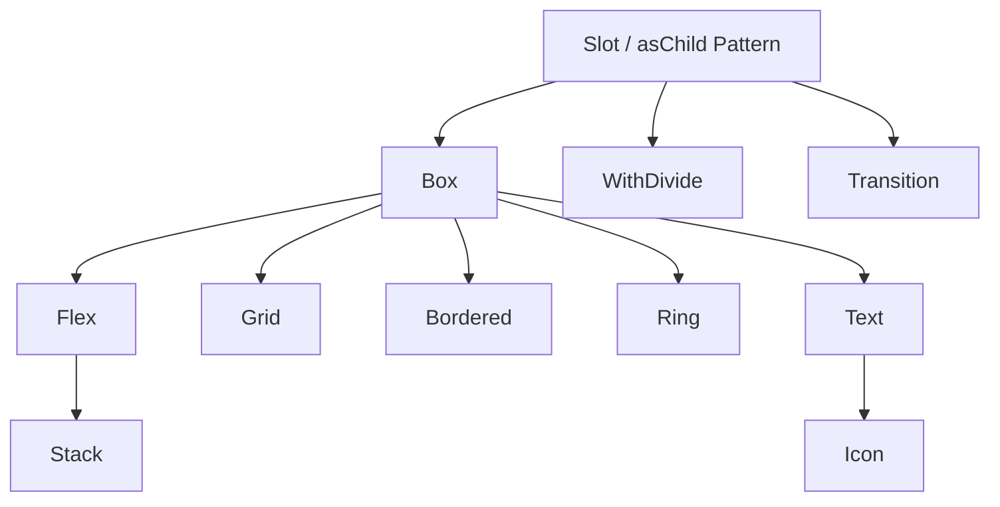

# Monolith Frontend UI Library Architecture & Usage Guide

The web and both native clients call `registerWorkspaceIcons()` from `@monolith/ui` before rendering. Shipped interface icons are versioned under `src/assets/icons` and do not require a public icon CDN at runtime. After adding interface icons, run `pnpm exec node tools/desktop-assets.mjs` and review the generated collections and attribution. User-selected icons outside that bundle still use the icon provider. Keep the icon notices in native distributions.

Welcome to the **Monolith UI Library Guide**. This document serves as the single source of truth for frontend development in the Monolith ecosystem. Anyone writing frontend code for Monolith must read this guide from cover to cover before writing a single line of code.

---

## 1. Core Philosophy & Architectural Overview

### Shared workspace interactions

The addon catalog uses Monolith's neutral surfaces and compact cards. Keep creator credits and source provenance in legal notices; catalog cards show the tool, description, type, category and workspace state. Search, status, category and type filters combine. Owner-only switches persist the workspace setting, announce save results, remain disabled while saving, and retain their previous state on failure. Use the shared Switch with scoped motion tokens and disable decorative motion for reduced-motion users.

Monolith combines compact, contextual database controls with a calm writing surface. Reference inspections of Notion, Craft and Obsidian inform behavior; components retain Monolith's tokens, accessibility and canonical data model. Core surfaces use restrained borders and shallow shadows. Atlas owns the optional note-oriented workbench with tool rail, document tabs, splits, graph and backlinks.

Use `FloatingPopover` for name/icon editors and contextual forms. Anchor it to the invoking row or control, flip at viewport edges, and keep the underlying layout stable. Use `ContextMenu` for actions, with `contextTarget` for right-click and Shift+F10. Escape dismisses the frontmost surface, keyboard focus returns to the invoker, and dropdowns opened inside a form remain usable. `IconPalette` provides a compact, searchable grid with named colors and a custom color input. Do not open a full-screen icon modal for ordinary page or folder customization.

Block selection uses a translucent fill with small corners and database cells use a thin outline. Both inherit --selection-color from the customization accent (blue by default), including text selection and nested page surfaces. Tag option colors belong to the property schema and are shared by table chips, page properties, and board cards. Database pages use the canonical editor title, compact property rows with anchored value popovers, comments before the body, and side/center/full-page presentation. Inline databases are valid children of callouts; background changes are document properties with undo support. Editable document titles keep a caret and subtle baseline rather than a rectangular focus frame. Each canonical block has one owned grip and selection gutter. The document text context menu remains native when a text range is selected; right-clicking the block background opens block actions.

Standard documents retain a comfortable reading width; Full width has no fixed 1480px ceiling and fills the available pane, including ultrawide displays. Embedded databases keep their own horizontal scroll when columns exceed the pane. Popovers use 110–120ms opacity/transform entry; hover feedback changes color without shifting geometry. Native scrolling and pointer hit targets remain immediate. Reduced motion disables decorative transitions.

The directly distributed macOS build disables WebKit's internal `PreferPageRenderingUpdatesNear60FPSEnabled` preference when present, allowing the native display scheduler to deliver ProMotion frames. Runtime feature detection falls back safely, and `MONOLITH_SYSTEM_REFRESH_POLICY=1` restores the system policy. This private API must be omitted from App Store builds until a public equivalent exists. Measure real animation-frame delivery and interaction tails; never infer achieved frame rate from display capability alone.

The Monolith UI library is built on a **zero-runtime CSS-in-JS** architecture powered by **[Vanilla Extract](https://vanilla-extract.style/)** and **[Sprinkles](https://vanilla-extract.style/documentation/packages/sprinkles/)**. This provides total type safety, compile-time optimization, and rich theme integration without the performance overhead of traditional CSS-in-JS solutions.

### Saving in dialogs

`FormModal` owns a native HTML form and a single pending submission. Do not nest another form inside it. Return or await the save promise from `submissionConfig.handler`; rejection leaves the draft open, and success closes the dialog. Its fields and cancel action remain disabled during submission. `ConfirmationModal` also awaits its handler, prevents duplicate requests, and presents failures inline. Update cached data through contract-derived query keys after successful writes.

### Two Strict Rules

> [!IMPORTANT]
> **RULE 1: NO TAILWINDCSS AT ALL**  
> Tailwind utility classes, `@apply` directives, `@reference`, `@layer`, and `theme()` are **forbidden** in all files - `.tsx`, `.css`, `.css.ts`, everywhere. All layout, spacing, typography, and styling must use the custom primitives or standard CSS custom properties. Third-party library overrides in `.css` files must use plain CSS with `var(--color-*)` custom properties - never `@apply`, `@layer`, or Tailwind classes. External library CSS should be imported with plain `@import` (no `layer()`).

> [!IMPORTANT]
> **RULE 2: NO INLINE STYLES FOR CORE LAYOUT & DESIGN**  
> Custom inline `style` objects must be avoided. If a style can be represented through component props or tokens, you **must** use those props. Inline styles are reserved solely for truly dynamic runtime calculations (e.g., coordinates from drag-and-drop events).

> [!IMPORTANT]
> **RULE 3: PRIMITIVES FIRST, INLINE STYLES AND CSS.TS LAST**  
> Every style must first be attempted using UI primitives (`Box`, `Flex`, `Stack`, `Grid`, `Text`, `Icon`, `Bordered`, `Ring`, `Button`, `Card`, etc.) and their props. Only when a style **cannot** be expressed through any primitive prop - even with `asChild` composition - should you resort to inline `style` or a `.css.ts` vanilla-extract file. Acceptable exceptions: `fontFamily` for custom fonts, `listStyleType` for list markers, `wordBreak` for table cells. If a `.css.ts` file is created, it must contain ONLY the styles that cannot be achieved through primitives - nothing more.

### Design Tokens & Dynamic Scaling

The design system defines global tokens under `vars` (compiled to CSS variables) that automatically scale with user personalisation settings:

- **Font Scale (`--custom-font-scale`):** Scales typography and padding/margin dynamically.
- **Border Radius Multiplier (`--custom-border-radius-multiplier`):** Auto-scales corners from sharp to pill-like.
- **Custom Themes (`.theme-[color]` & `.bg-[palette]`):** Sets theme shades for brand colors (`--color-custom-*`) and background palettes (`--color-bg-*` like slate, zinc, neutral, mauve, olive, mist, taupe).

---

## 2. Global Token Systems

All standard layout and typography options are referenced via type-safe tokens exported by the system.

### A. Spacing & Margin/Padding Tokens

Spacing scales are defined under `vars.space` and scale with font size to keep visual rhythm:

- `none`: `'0'`
- `xs`: `calc(var(--spacing) * 1)` (equivalent to `4px` base)
- `sm`: `calc(var(--spacing) * 2)` (`8px` base)
- `md`: `calc(var(--spacing) * 4)` (`16px` base)
- `lg`: `calc(var(--spacing) * 6)` (`24px` base)
- `xl`: `calc(var(--spacing) * 8)` (`32px` base)
- `2xl`: `calc(var(--spacing) * 12)` (`48px` base)
- `3xl`: `calc(var(--spacing) * 16)` (`64px` base)

### B. Border Radius (Rounding) Tokens

Border corners are defined under `vars.radii` and scale with the user's corner multiplier (`--custom-border-radius-multiplier`; independent of font scale). The compact workspace uses a fixed 4px base radius step. Spacing still follows the font scale, so match nested corners to the actual rendered padding.

| Token  | Raw value           | Multiple of `4px` | Default radius |
| :----- | :------------------ | :---------------- | :------------- |
| `none` | `0`                 | -                 | `0`            |
| `sm`   | `var(--radius-sm)`  | `1`               | `4px`          |
| `md`   | `var(--radius-md)`  | `2`               | `8px`          |
| `lg`   | `var(--radius-lg)`  | `3`               | `12px`         |
| `xl`   | `var(--radius-xl)`  | `4`               | `16px`         |
| `2xl`  | `var(--radius-2xl)` | `5`               | `20px`         |
| `3xl`  | `var(--radius-3xl)` | `6`               | `24px`         |
| `full` | `9999px`            | -                 | pill           |

#### Concentric nested corners

When a rounded element sits inside another one with padding, keep the corners concentric using `inner radius = outer radius - padding`. At a 16px font base and a radius multiplier of 1, the following combinations map exactly to tokens; adjust for personalized scaling:

| Outer radius | Padding | Inner radius |
| :----------- | :------ | :----------- |
| `md`         | `xs`    | `sm`         |
| `lg`         | `xs`    | `md`         |
| `lg`         | `sm`    | `sm`         |
| `xl`         | `xs`    | `lg`         |
| `xl`         | `sm`    | `md`         |
| `2xl`        | `sm`    | `lg`         |
| `3xl`        | `sm`    | `xl`         |

When the outer radius is less than or equal to the padding, the inner element should use `r="none"` - a square inner corner reads as concentric because it never crosses the outer corner's curve.

### C. Typography Scales

Typography values scale with `--custom-font-scale`:

| Size Token | Font Size (`fontSize`) | Line Height (`lineHeight`)      |
| :--------- | :--------------------- | :------------------------------ |
| `xs`       | `var(--text-xs)`       | `var(--text-xs--line-height)`   |
| `sm`       | `var(--text-sm)`       | `var(--text-sm--line-height)`   |
| `base`     | `var(--text-base)`     | `var(--text-base--line-height)` |
| `lg`       | `var(--text-lg)`       | `var(--text-lg--line-height)`   |
| `xl`       | `var(--text-xl)`       | `var(--text-xl--line-height)`   |
| `2xl`      | `var(--text-2xl)`      | `var(--text-2xl--line-height)`  |
| `3xl`      | `var(--text-3xl)`      | `var(--text-3xl--line-height)`  |
| `4xl`      | `var(--text-4xl)`      | `var(--text-4xl--line-height)`  |
| `5xl`      | `var(--text-5xl)`      | `1`                             |
| `6xl`      | `var(--text-6xl)`      | `1`                             |
| `7xl`      | `var(--text-7xl)`      | `1`                             |
| `8xl`      | `var(--text-8xl)`      | `1`                             |
| `9xl`      | `var(--text-9xl)`      | `1`                             |

**Font Weights:**

- `normal`: `'400'`
- `medium`: `'500'`
- `semibold`: `'600'`
- `bold`: `'700'`

### D. Category/Tag Chips

For dynamic category labels or tag chips that need background colors based on data (not theme tokens), use **inline `style` with `backgroundColor`** set directly from the data source. Do NOT create `.css.ts` files for one-off dynamic colors - inline styles are the correct pattern here because the color value is computed at runtime from external data.

✅ **Correct (dynamic colors from data):**

```tsx
<span
  style={{
    backgroundColor: category.color + '20',
    color: category.color
  }}
>
  {category.name}
</span>
```

> [!TIP]
> **Dynamic category colors are the exception to Rule 2.** If the background/color pair comes from database or API data (e.g. `bg-green-500/20 text-green-500`), use inline `style` with hex color + opacity. Do not create token mappings or CSS files for dynamic data-driven colors.

---

## 3. Style Resolution & The Styling Engine

Monolith uses a custom styling resolver, `resolveStyles()`, which translates token-based properties and responsive objects into static class names and CSS custom properties at runtime.

### A. Color Properties & State Resolvers

Colors in Monolith are resolved through an **arbitrary CSS variable architecture** that handles dynamic user personalization and interactions. The primary color properties are:

- `bg`: Background Color (`--monolith-bg`)
- `color`: Text/Foreground Color (`--monolith-color`)
- `borderColor`: Border Color (`--monolith-border-color`)
- `ringColor`: Focus Ring Color (`--monolith-ring-color`)
- `ringOffsetColor`: Offset Ring Color (`--monolith-ring-offset-color`)
- `divideColor`: Dividing Line Color (`--monolith-divide-color`)

#### Supported Color Keys

1. **Base Palette:** `transparent`, `dangerous` (`#ef4444`), `muted` (mid-gray), `primary` (user-accented), `inherit`, `custom-50` to `custom-900` (accent shades), and `bg-50` to `bg-950` (system background shades).
2. **Tailwind Palette Names:** Colors like `red-500`, `blue-600`, `emerald-400` map directly to tailwind shades.
3. **Color with Opacity:** Zero-runtime opacity can be added using the `colorWithOpacity(token, opacityValue)` utility.
4. **No `white` or `black` color tokens.** Use `bg-50` for white and `bg-950` for black. The `green-*`, `red-*`, `yellow-*`, and other Tailwind palette names are available for semantic colors (e.g. `red-500` for destructive states, `green-600` for success).

#### Theme & State Specific Variants

Any color prop can receive a static color value or a map of conditions representing interactive states:

````typescript
type ThemeConditionPropName =
  | 'base' // Default style
  | 'dark' // Dark mode
  | 'hover' // Hover state
  | 'darkHover' // Hover state in dark mode
  | 'hasBgImage' // Active when page has a background image
  | 'darkHasBgImage' // Active in dark mode with a background image
  | 'hasBgImageHover'
  | 'hasBgImageDarkHover'
  | 'print' // Active under print media query

##### Example Usage:

```tsx
<Box
  bg={{
    base: 'bg-50',
    dark: 'bg-900',
    hover: 'bg-200',
    darkHover: 'bg-800',
    print: 'transparent'
  }}
  color={{ base: 'bg-950', dark: 'bg-50', print: 'black' }}
/>
````

#### Pre-built Surface Presets (`surface`)

The most common background patterns are available as a pre-built `surface` object exported from `@monolith/ui`:

```typescript
import { surface } from '@monolith/ui'

// Light static surface - for non-interactive light backgrounds
surface.light
// => { base: colorWithOpacity('bg-200', '50%'), dark: colorWithOpacity('bg-800', '50%') }

// Light interactive surface - the unified background for all inputs/controls
// (TextInput, CurrencyInput, NumberInput, DateInput, ColorInput, IconInput,
//  TextAreaInput, TagsInput, Listbox, ListboxInput, ComboboxInput, SearchInput,
//  FileInput, and selectable Cards)
surface.lightInteractive
// => { base: colorWithOpacity('bg-200', '50%'), dark: colorWithOpacity('bg-800', '70%'),
//      hover: colorWithOpacity('bg-200', '70%'), darkHover: colorWithOpacity('bg-700', '50%') }

// Default surface - for static Cards
surface.default
// => { base: 'bg-50', dark: 'bg-900' }

// Default interactive surface - for clickable Cards
surface.defaultInteractive
// => { base: 'bg-50', dark: 'bg-900', hover: colorWithOpacity('bg-50', '70%'), darkHover: 'bg-800' }
```

These are `as const` objects that can be spread or passed directly into the `bg` prop:

```tsx
<Listbox bg={surface.light} ... />
<Card bg={surface.lightInteractive} ... />    {/* Override Card's default */}
<Card isInteractive ... />                    {/* Uses surface.defaultInteractive automatically */}
```

> **Inputs** default to `surface.lightInteractive`; every `*Input` component accepts a
> `wrapperProps` prop that is forwarded to its `InputWrapper` (a `Flex`), e.g.
> `<DateInput wrapperProps={{ bg: surface.default }} />`. The `Card` component defaults to
> `surface.default` / `surface.defaultInteractive`.

### B. Opacity Modifiers (`colorWithOpacity`)

To prevent heavy runtimes, colors can be blended with transparency using CSS `color-mix` through the `colorWithOpacity` helper:

```typescript
import { colorWithOpacity } from '@monolith/ui'

// Generates: color-mix(in srgb, var(--color-custom-500) 30%, transparent)
const semiTransparentPrimary = colorWithOpacity('primary', '30%')
```

_Supported Opacity Levels:_ `'5%'`, `'10%'`, `'20%'`, `'30%'`, `'40%'`, `'50%'`, `'60%'`, `'70%'`, `'80%'`, `'90%'`.

`colorWithOpacity` can be used **directly in the `bg` prop** - no inline `style` needed. It also works in vanilla-extract `.css.ts` files at build time via `.toString()`:

```typescript
// In a .css.ts file (build-time evaluation)
import { colorWithOpacity } from '@monolith/ui'

const bg200Opacity30 = colorWithOpacity('bg-200', '30%').toString()

export const stripe = style({
  selectors: {
    '&:nth-child(odd)': {
      backgroundColor: bg200Opacity30
    }
  }
})
```

> **Important:** `colorWithOpacity` with `'80%'` opacity is the correct replacement for Tailwind's `/80` opacity syntax (e.g. `bg-500/80`). Do not use inline `style` for opacity.

```tsx
<Flex
  align="center"
  bg={colorWithOpacity('custom-500', '20%')}
  justify="center"
  p="md"
  r="md"
>
  <Icon color="primary" icon="tabler:box" />
</Flex>
```

This replaces the old pattern of inline `style={{ backgroundColor: 'color-mix(...)' }}`.

### C. Responsive Properties & Breakpoints

Layout props support responsive values. Breakpoints are defined as:

- `base`: Mobile first (default, no media query)
- `sm`: `@media (min-width: 640px)`
- `md`: `@media (min-width: 768px)`
- `lg`: `@media (min-width: 1024px)`
- `xl`: `@media (min-width: 1280px)`
- `2xl`: `@media (min-width: 1536px)`
- `print`: `@media print` (active under print mode)

Any responsive property accepts a scalar or a responsive configuration object:

```tsx
// Single width everywhere
<Box width="100%" />

// Responsive width
<Box width={{ base: '100%', md: '50%', lg: '33.33%' }} />

// Hide element during printing
<Box display={{ base: 'block', print: 'none' }} />
```

_How it works under the hood:_ The engine applies `.monolith-w` and `.md:monolith-w` classes while defining CSS variables (`--monolith-w: 100%`, `--monolith-w-md: 50%`) inline, keeping output stylesheet sizes extremely small.

---

## 4. The Core Primitives

Primitives are the architectural blocks from which all higher-level views are constructed. They all support `as` and `asChild` composition.



---

### A. Box

The foundational primitive. Renders a `div` by default. It manages spacing, padding, basic layout variables, borders, and rounded corners.

```typescript
interface BoxOwnProps<T extends ElementType = 'div'> {
  as?: T                     // Semantic tag override (e.g. 'section', 'form')
  asChild?: boolean          // Radix Slot composition
  display?: ResponsiveProp<'block' | 'inline' | 'inline-block' | 'none' | 'contents'>
  bg?: ThemeConditionProp<ColorValue>
  shadow?: boolean           // Applies smooth global card shadow (deactivated in dark mode)

  // Padding & Margin (Uses SpaceTokens)
  p?: ResponsiveProp<SpaceToken>; px?: ResponsiveProp<SpaceToken>; py?: ResponsiveProp<SpaceToken>
  pt?: ResponsiveProp<SpaceToken>; pb?: ResponsiveProp<SpaceToken>; pl?: ResponsiveProp<SpaceToken>; pr?: ResponsiveProp<SpaceToken>
  m?: ResponsiveProp<SpaceToken>; mx?: ResponsiveProp<SpaceToken>; my?: ResponsiveProp<SpaceToken>
  mt?: ResponsiveProp<SpaceToken>; mb?: ResponsiveProp<SpaceToken>; ml?: ResponsiveProp<SpaceToken>; mr?: ResponsiveProp<SpaceToken>

  // Custom Size & Positioning (Responsive CSS strings/numbers)
  width?: ResponsiveProp<string>; height?: ResponsiveProp<string>
  minWidth?: ResponsiveProp<string>; maxWidth?: ResponsiveProp<string>
  minHeight?: ResponsiveProp<string>; maxHeight?: ResponsiveProp<string>
  inset?: ResponsiveProp<string>; top?: ResponsiveProp<string>; bottom?: ResponsiveProp<string>
  left?: ResponsiveProp<string>; right?: ResponsiveProp<string>; zIndex?: ResponsiveProp<string>

  // Arbitrary CSS Props (responsive strings)
  aspectRatio?: ResponsiveProp<string>
  flex?: ResponsiveProp<string>; flexBasis?: ResponsiveProp<string>
  flexGrow?: ResponsiveProp<string>; flexShrink?: ResponsiveProp<string>
  overflow?: ResponsiveProp<'visible' | 'hidden' | 'scroll' | 'auto'>
  overflowX?: ResponsiveProp<'visible' | 'hidden' | 'scroll' | 'auto'>
  overflowY?: ResponsiveProp<'visible' | 'hidden' | 'scroll' | 'auto'>
```

> [!TIP]
> **`aspectRatio`, `overflow`, `flex`, `flexGrow`, `flexShrink`, `flexBasis` are available as props on all primitives** - no inline `style` needed. Always check if a CSS property exists in the `ArbitraryProps` type before resorting to inline styles.

> [!WARNING]
> **`top`, `right`, `bottom`, `left`, and `inset` accept raw CSS strings** (e.g. `"0.5rem"`, `"8px"`, `"50%"`), not `SpaceToken` values like `sm`, `md`, `lg`.  
> Spacing tokens only work with padding (`p`, `px`, `py`, `pt`, `pr`, `pb`, `pl`) and margin (`m`, `mx`, `my`, `mt`, `mr`, `mb`, `ml`) props.  
> ❌ `top="sm"` - will not resolve  
> ✅ `top="0.5rem"` - correct
>
> **`top`, `right`, `bottom`, `left`, and `inset` are NOT tokenized.** They do not accept spacing tokens (`sm`, `md`, `lg`) - only raw CSS values. These properties are used for absolute/fixed positioning, which is inherently pixel/length-based and does not benefit from the token system's font-scaling.

// Border Radius (Uses RadiusTokens)
r?: ResponsiveProp<RadiusToken> // All corners
rtl?: ResponsiveProp<RadiusToken> // Top Left
rtr?: ResponsiveProp<RadiusToken> // Top Right
rbl?: ResponsiveProp<RadiusToken> // Bottom Left
rbr?: ResponsiveProp<RadiusToken> // Bottom Right
}

````

#### Example:
```tsx
<Box
  as="section"
  bg={{ base: 'bg-50', dark: 'bg-950' }}
  p="lg"
  r="xl"
  shadow
  width={{ base: '100%', md: '50rem' }}
>
  Box Content
</Box>
````

---

### B. Flex

Implements a flexbox container. Renders a `flex` layout by default.

```typescript
interface FlexOwnProps extends BoxOwnProps {
  display?: ResponsiveProp<'none' | 'flex' | 'inline-flex'>
  direction?: ResponsiveProp<
    'row' | 'column' | 'row-reverse' | 'column-reverse'
  >
  align?: ResponsiveProp<'stretch' | 'center' | 'start' | 'end' | 'baseline'>
  justify?: ResponsiveProp<
    'start' | 'center' | 'between' | 'around' | 'evenly' | 'end'
  >
  wrap?: ResponsiveProp<'nowrap' | 'wrap' | 'wrap-reverse'>
  centered?: boolean // Shortcut to center children perfectly on both axes
  gap?: ResponsiveProp<SpaceToken>
  gapX?: ResponsiveProp<SpaceToken>
  gapY?: ResponsiveProp<SpaceToken>
}
```

#### Example: Responsive Navbar

```tsx
<Flex
  align="center"
  direction={{ base: 'column', sm: 'row' }}
  justify="between"
  p="md"
  gap="sm"
>
  <Text weight="bold">Logo</Text>
  <Flex gap="md">
    <Text>Home</Text>
    <Text>About</Text>
  </Flex>
</Flex>
```

---

### C. Grid

Implements a CSS grid container with specialized normalization utilities.

```typescript
interface GridOwnProps extends BoxOwnProps {
  display?: ResponsiveProp<'none' | 'grid' | 'inline-grid'>
  templateCols?: ResponsiveProp<number | string> // Numbers auto-resolve to 'repeat(N, 1fr)'
  templateRows?: ResponsiveProp<number | string>
  flow?: ResponsiveProp<
    'row' | 'column' | 'dense' | 'row dense' | 'column dense'
  >
  align?: ResponsiveProp<'stretch' | 'center' | 'start' | 'end' | 'baseline'>
  justify?: ResponsiveProp<'start' | 'center' | 'end' | 'between'>
  gap?: ResponsiveProp<SpaceToken>
  gapX?: ResponsiveProp<SpaceToken>
  gapY?: ResponsiveProp<SpaceToken>
}
```

#### Grid Item Options (Passed to children inside any Primitive):

Grid children can utilize custom positioning properties which auto-resolve:

- `gridColumnSpan` (e.g., `2` resolves to `span 2`)
- `gridRowSpan` (e.g., `3` resolves to `span 3`)
- `gridArea`

#### Example: Responsive 3-Column Card Layout

```tsx
<Grid templateCols={{ base: 1, md: 3 }} gap="lg" width="100%">
  <Box bg="bg-200" p="md">
    Card 1
  </Box>
  <Box bg="bg-200" p="md" gridColumnSpan={{ base: 1, md: 2 }}>
    Card 2 (Spans 2 columns on desktops)
  </Box>
  <Box bg="bg-200" p="md">
    Card 3
  </Box>
</Grid>
```

---

### D. Stack

A highly optimized, pre-configured `Flex` container intended for vertical lists. It overrides default flex directions to `column` and sets default width/sizing constraints.

```tsx
// Stack Definition
export function Stack<T extends ElementType = 'div'>(props: FlexProps<T>) {
  return (
    <Flex direction="column" gap="sm" minWidth="0" width="100%" {...props} />
  )
}
```

#### Example:

For listing content, Stack's default `gap="sm"` is usually sufficient - no need to explicitly set `gap`:

```tsx
<Stack>
  <Text>Item 1</Text>
  <Text>Item 2</Text>
  <Text>Item 3</Text>
</Stack>
```

Override `gap` only when you need more or less spacing than the default:

```tsx
<Stack gap="md">
  <Text size="lg">Form Title</Text>
  <TextInput placeholder="Enter text..." ... />
  <Button>Submit</Button>
</Stack>
```

---

### E. Text

The absolute engine for typography. Renders a `span` by default. It manages clipping, white-space constraints, tracking, and leading.

```typescript
interface TextOwnProps {
  size?: ResponsiveProp<TextSize> // xs to 9xl
  color?: ThemeConditionProp<ColorValue>
  bg?: ThemeConditionProp<ColorValue>
  weight?: ResponsiveProp<FontWeight> // normal, medium, semibold, bold
  align?: ResponsiveProp<'left' | 'center' | 'right'>
  decoration?: ResponsiveProp<'underline' | 'line-through' | 'none'>
  transform?: ResponsiveProp<'uppercase' | 'lowercase' | 'capitalize' | 'none'>
  wrap?: ResponsiveProp<'wrap' | 'nowrap' | 'pretty' | 'balance'>
  whiteSpace?: ResponsiveProp<
    'normal' | 'nowrap' | 'pre' | 'pre-line' | 'pre-wrap'
  >
  truncate?: boolean // Ellipsis clipping on a single line
  lineClamp?: number // Standard multi-line truncation
  tracking?: ResponsiveProp<
    'tighter' | 'tight' | 'normal' | 'wide' | 'wider' | 'widest'
  >
  leading?: ResponsiveProp<
    'none' | 'tight' | 'snug' | 'normal' | 'relaxed' | 'loose'
  >
}
```

#### Example: Headline and Subtitle

`Text` also accepts all spacing props (`mt`, `mb`, `py`, `px`, etc.) and `style` directly - no wrapping `Box` needed.

```tsx
<Stack gap="xs">
  <Text as="h1" size="3xl" weight="bold" leading="tight" tracking="tight">
    Create Account
  </Text>
  <Text color="muted" size="base">
    Welcome back to Monolith.
  </Text>
</Stack>

<Text as="p" mt="md" py="sm" style={{ fontFamily: 'Inter' }}>
  Direct spacing and style - no Box wrapper.
</Text>
```

---

### F. Icon

Wraps `@iconify/react` into a text-compatible block. Inherits the text color of the parent container by default and maps custom sizes seamlessly.

```typescript
type IconProps = Omit<TextProps, 'size'> & {
  icon: string // e.g. "tabler:pencil", "tabler:hammer"
  size?: ResponsiveProp<string | number> // Defaults to '1.25em'
}
```

> The default size of `Icon` is **`1.25em`**, which works well alongside `Text size="base"`. Only pass `size` explicitly when you need a different size (e.g. `size="1.5em"` for larger decorative icons). Do NOT redundantly specify `size="1.25em"` - it is the default.

#### Example:

```tsx
<Flex align="center" gap="sm">
  <Icon color="primary" icon="tabler:settings" />{' '}
  {/* Size defaults to 1.25em */}
  <Text>Settings</Text>
</Flex>
```

---

### G. Bordered

A primitive specifically made to draw layout borders without writing custom CSS borders.

```typescript
interface BorderedOwnProps extends BoxOwnProps {
  borderColor?: ThemeConditionProp<ColorValue> // Defaults to base: 'bg-300', dark: 'bg-600'
  borderStyle?: 'solid' | 'dashed' | 'dotted' | 'double' | 'none'
  borderSide?: 'all' | 'top' | 'right' | 'bottom' | 'left' | 'x' | 'y'
  borderWidth?: string // Defaults to '1px'
}
```

#### Example: Side Border Sidebar

```tsx
<Bordered
  borderSide="right"
  borderColor={{ base: 'bg-200', dark: 'bg-800' }}
  borderWidth="2px"
  height="100vh"
  width="16rem"
>
  Sidebar content
</Bordered>
```

---

### H. Ring

Renders an interactive outline (focus rings, custom borders) mapping dynamically to states. Ideal for input focus effects.

```typescript
interface RingProps extends BoxOwnProps {
  ringWidth?: ResponsiveProp<string> // Defaults to '3px'
  ringColor?: ThemeConditionProp<ColorValue> // Defaults to 'custom-500'
  ringOffsetWidth?: ResponsiveProp<string> // Defaults to '0px'
}
```

#### Example:

```tsx
<Ring ringWidth="2px" ringColor="primary" r="md">
  <button>Clickable Element</button>
</Ring>
```

---

### I. WithDivide

An extremely clever composition primitive that adds borders between adjacent sibling nodes. It avoids needing `border-bottom` logic on item render lists.

```typescript
interface WithDivideProps {
  axis?: 'x' | 'y' // 'y' divides vertically (adds borderTop)
  // 'x' divides horizontally (adds borderLeft)
  color?: ThemeConditionProp<ColorValue> // Defaults to base: bg-200, dark: bg-700
  children?: ReactNode
}
```

`WithDivide` must wrap **each individual item**, not a parent container. It adds a divider between adjacent `WithDivide` siblings.

#### Example: List Group Dividers

```tsx
<Stack gap="none">
  {items.map(item => (
    <WithDivide
      key={item.id}
      axis="y"
      color={{ base: 'bg-300', dark: 'bg-800' }}
    >
      <Box p="md">{item.name}</Box>
    </WithDivide>
  ))}
</Stack>
```

---

### J. Transition

Applies CSS transitions to a wrapped component utilizing the `asChild` composition pattern. No wrapper elements are injected into the DOM.

```typescript
interface TransitionProps {
  duration?: number | string // e.g. 200, '300ms', '0.2s'. Defaults to '100ms'
  easing?:
    'linear' | 'ease' | 'ease-in' | 'ease-out' | 'ease-in-out' | (string & {})
  delay?: number | string
  property?:
    PropertyValue | TransitionEntry | Array<PropertyValue | TransitionEntry>
}
```

#### Example: Smooth Color Change on Hover

```tsx
<Transition duration="150ms" property={['background-color', 'color']}>
  <Box
    bg={{ base: 'bg-100', hover: 'primary' }}
    color={{ base: 'bg-950', hover: 'bg-50' }}
    p="md"
    r="md"
  >
    Hover Me
  </Box>
</Transition>
```

---

### K. Prose

A rich-text wrapper component that automatically styles standard HTML/Markdown elements cleanly according to the active theme. Useful for rendering documentation, wiki pages, or comments without manual style overrides.

```typescript
export function Prose({
  className,
  style,
  children
}: {
  className?: string
  style?: CSSProperties
  children?: ReactNode
})
```

#### Supported Child Element Styling:

- **Headings (`h1` - `h6`):** Automatically styled with appropriate sizing, weights, line-heights, and margins.
- **Lists (`ul`, `ol`, `li`):** Renders margins, paddings, list-style-type (`disc`/`decimal`), and markers styled with the `bg-400` token.
- **Code Blocks & Inline Code (`kbd`, `code`, `pre`):** Automatically styled with clean borders, background colors, custom SFMono fonts, rounded corners, and shadows.
- **Blockquotes:** Rendered with vertical accent borders, custom quotes, margins, and custom text colors matching light/dark modes.
- **Tables:** Fully styled table layouts with borders, headers (`thead`), zebra-striping/row boundaries, and proper cell alignments.
- **Media (`img`, `video`, `picture`):** Automatically centered with `max-width: 100%` and rounded corners.

#### Example:

```tsx
<Prose>
  <h1>Guide Title</h1>
  <p>
    Here is some text with <strong>bold</strong> styling and a{' '}
    <a href="#">link</a>.
  </p>
  <ul>
    <li>Bullet item 1</li>
    <li>Bullet item 2</li>
  </ul>
</Prose>
```

---

## 5. Composition & Chaining Rules

Primitives are designed to be composed together using the `asChild` pattern. This merges the class names, styling resolvers, and custom variables of multiple layers onto a single DOM node.

### A. The `asChild` composition

When `asChild` is set, the primitive passes all of its compiled props and styles directly to its only child.

```tsx
// ❌ INCORRECT: Injects redundant DOM elements, making styling hard to trace
<Transition>
  <Box bg="primary" p="md">
    <Text as="h3" size="lg">Headline</Text>
  </Box>
</Transition>

//     CORRECT: Flattens the hierarchy into a single clean DOM node
<Transition duration="200ms" property="all">
  <Box
    asChild
    bg={{ base: 'bg-100', hover: 'bg-200' }}
    p="md"
    r="md"
  >
    <Text as="h3" size="lg">Headline</Text>
  </Box>
</Transition>
```

### B. Standard Layout Chain

When constructing standard layout components, follow this order:

1. **Structural Grid/Stack:** Define overall templates and spacing bounds.
2. **Interactive/Animated Transition:** Handle states and transition variables.
3. **Card/Bordered Wrapper:** Render the visible card backgrounds, shadows, and corners.
4. **Content Flex/Stack:** Lay out content alignment and gaps.

```tsx
<Grid templateCols={{ base: 1, md: 3 }} gap="lg">
  {items.map(item => (
    <Transition key={item.id} duration="150ms" property="all">
      <Bordered asChild bg={{ base: 'bg-100', hover: 'bg-200' }} p="lg" r="lg">
        <Stack gap="md">
          <Text size="xl" weight="bold">
            {item.title}
          </Text>
          <Text color="muted">{item.desc}</Text>
        </Stack>
      </Bordered>
    </Transition>
  ))}
</Grid>
```

---

## 6. High-Level Forms & Interactive Components

### A. Button

The core button component manages accessibility, internationalization translations, dynamic loading spinners, and personalization background-contrast matching.

```typescript
type ButtonProps<T extends ElementType = 'button'> = ButtonOwnProps &
  FlexProps<T>
```

| Category                | Props                                                                                                                      |
| ----------------------- | -------------------------------------------------------------------------------------------------------------------------- |
| **Button-specific**     | `variant`, `dangerous`, `icon`, `iconPosition`, `loading`, `disabled`, `namespace`                                         |
| **Inherited from Flex** | All `FlexProps` - `mt`, `width`, `position`, `top`, `gap`, and everything from `BoxProps` (`bg`, `p`, `r`, `shadow`, etc.) |

Since `Button` extends `FlexProps` (which extends `BoxProps`), **any layout prop available on `Flex` or `Box` can be passed directly** - no wrapping `Box` needed. Only reach for `Box asChild` when you need a prop that Flex/Box doesn't support (e.g. CSS properties only available via inline `style`).

#### Notable Engineering Features:

1. **Dynamic Contrast Matching:** In `useButtonStyleProps`, when `variant="primary"` is set, the button fetches the user's active theme color (`derivedThemeColor`) and runs `getMostReadableColor()` to compute a text color with optimal contrast.
2. **Smart i18n Translation:** If the children is a string, it automatically attempts to search for translations across various namespaces (e.g., `buttons.cancel`, `common.buttons:cancel`).
3. **Loading Spinners:** Renders `svg-spinners:ring-resize` with or without an `icon` prop. Iconless loading preserves the content's layout and accessible name. `aria-busy` marks pending work; disabled/loading buttons prevent activation even when rendered as links.

#### Example:

```tsx
<Button
  icon="tabler:send"
  loading={isSubmitting}
  mt="lg" // Inherited from Flex - no Box wrapper needed
  width="100%" // Inherited from Flex
  onClick={onSubmit}
>
  sendFeedback
</Button>
```

---

### B. Input Components & Infrastructure

All raw input components share a unified visual style by extending components from the `inputs/shared` module:

- `InputWrapper`: Creates the surrounding classic/plain background field, error display, and click handlers.
- `InputLabel`: Coordinates labels, required asterisks, and floating positions.
- `InputIcon`: Renders helper icons aligned within field paddings.

#### Available Inputs in SDK:

- **`TextInput`:** Controlled input box. Supports standard inputs, passwords with custom visibility toggles, and action buttons.
- **`NumberInput` / `CurrencyInput`:** Custom formatted fields for numbers and currencies.
- **`TextAreaInput`:** Multiline text input area.
- **`Switch` / `Checkbox`:** Toggle switches and checkboxes.
- **`FAB`:** Floating Action Button.
- **`ColorInput` / `FileInput` / `IconInput`:** Advanced pickers that open specialized modals (`ColorPickerModal`, `FilePickerModal`, `IconPickerModal`).
- **`TagsInput`:** Multi-tag editor.
- **`LocationInput`:** Address/coordinates selector.
- **`SliderInput`:** Range slider selector.
- **`ListboxInput` / `ComboboxInput`:** Select/combobox dropdowns with search, options selection, and validation styling.
- **`QRCodeScanner`:** Quick QR code input scanner dialog.

---

### C. React Hook Form Integration & FormModal

Monolith integrates forms via `react-hook-form` controllers to provide a type-safe form state and automated validation messaging.

#### 1. FormModal

A dialog wrapper that encapsulates form state management and submission configurations.

Standard `FormModal` editors open as compact anchored popovers through `ModalManager`, retaining validation and submission handling. The manager captures the invoking control for placement and focus return. Outside clicks dismiss a clean editor; a dirty or submitting editor stays open until an explicit action. Use `FloatingPopover` or `PopoverButton` for small contextual settings, rather than inline `<details>` forms.

Use `AnimatedCollapse` for expandable properties, navigation and grouped content. Keep it mounted while changing `open`; pair its `id` with the trigger's `aria-controls` and `aria-expanded`. The closed content becomes inert immediately while its height settles. Reduced motion removes the transition. `ColorPicker` offers preset and custom colors; an undefined value follows `--selection-color`.

```typescript
type SubmissionConfig<T extends FieldValues> =
  | {
      template: 'create' | 'update'
      disabled?: boolean
      handler: (data: T) => Promise<unknown> | unknown
    }
  | {
      label: string
      icon: string
      disabled?: boolean
      handler: (data: T) => Promise<unknown> | unknown
    }
```

- **i18n Namespace Context:** Automatically provides a namespace to nested fields via `useNamespace()`.
- **Loading states:** Switches the form layout to a loading spinner during network requests.
- **Auto-Loading Submission Button:** Uses `usePromiseLoading` to display a spinner inside the button during async handler resolution.

#### 2. Specialized Form Fields

Form Fields (e.g. `TextField`, `CheckboxField`, `ListboxField`, `DateField`, `FileField`, etc.) wrap raw inputs inside `useController`, allowing binding via `control` and `name` props:

```tsx
<FormModal
  form={form}
  uiConfig={{
    title: 'Edit Profile',
    icon: 'tabler:user',
    onClose: close
  }}
  submissionConfig={{
    template: 'update',
    handler: async data => {
      await updateProfile(data)
    }
  }}
>
  <TextField
    control={form.control}
    name="username"
    label="Username"
    icon="tabler:user"
    required
  />
  <CheckboxField
    control={form.control}
    name="active"
    label="Active Account"
    icon="tabler:check"
  />
</FormModal>
```

#### 3. Zod Default Values Generator (`createDefaultValues`)

Before initializing a form, use `createDefaultValues(schema)` to parse the Zod validation schema and return type-safe, empty defaults:

```typescript
import { z } from 'zod'

import { createDefaultValues } from '@monolith/ui'

const userSchema = z.object({
  name: z.string(),
  age: z.number().default(18),
  roles: z.array(z.string())
})

const defaultValues = createDefaultValues(userSchema)
// => { name: '', age: 18, roles: [] }
```

---

## 7. Overlays, Modals & Context Menus

### A. Context Menu

A hover/click dropdown menu built on Radix UI's Dropdown Menu primitives.

```typescript
interface MenuProps {
  children: React.ReactNode
  customIcon?: string
  buttonComponent?: React.ReactNode
  align?: 'start' | 'center' | 'end'
  side?: 'top' | 'right' | 'bottom' | 'left'
}
```

- **ContextMenuItem:** Represents a single button in the dropdown menu. It is wrapped in `WithDivide` to automatically render separators. It supports `checked` (renders checkmark), `loading` (shows spinner), and `dangerous` (turns red) states.
- **ContextMenuGroup:** Renders sub-sections inside the menu.

#### Example:

```tsx
<ContextMenu align="end">
  <ContextMenuGroup>
    <ContextMenuItem label="edit" icon="tabler:pencil" onClick={handleEdit} />
    <ContextMenuItem
      dangerous
      label="delete"
      icon="tabler:trash"
      onClick={handleDelete}
    />
  </ContextMenuGroup>
</ContextMenu>
```

---

### B. Modal System

Monolith features a robust, portal-based modal stack manager.

#### 1. ModalProvider & useModalStore

State store context that manages a stack of open modals. It provides hooks to interact programmatically:

- `open(Component, data)`: Pushes a new modal onto the stack.
- `close()`: Closes the topmost active modal.
- `remove(index)`: Destroys a modal after exit animations finish.

#### 2. ModalManager & ModalWrapper

Renders the portal container at the application root level. Maps over the stack and places items inside a `ModalWrapper`, which manages scaling enter/leave transitions and overlays.

#### 3. ConfirmationModal

A pre-built confirmation dialog for destructive actions:

- Supports a `confirmationPrompt` string where the user must type a specific word (e.g. "DELETE") to enable the primary button.
- Handles loader spinners during confirmation hooks.

```tsx
const { open } = useModalStore()

open(ConfirmationModal, {
  title: 'Delete Repository',
  description: 'This action cannot be undone. Please type DELETE to confirm.',
  confirmationPrompt: 'DELETE',
  confirmationButton: 'delete',
  onConfirm: async () => {
    await deleteRepository()
  }
})
```

---

## 8. Layout, Header & Sidebar Infrastructure

### A. Card

The basic block container for laying out groups of information.

- **Inherits FlexProps:** Because `Card` extends `FlexProps`, any layout or alignment property can be passed directly to Card (e.g. `direction="row"`, `gap="md"`, `align="center"`).
- **Interactive Preset:** Passing `isInteractive` automatically sets cursor styles, shadows, transitions, and configures background state presets:

  ```typescript
  // isInteractive = false
  bg={surface.default} // base: 'bg-50', dark: 'bg-900'

  // isInteractive = true
  bg={surface.defaultInteractive} // base: 'bg-50', hover: 'bg-100', dark: 'bg-900', darkHover: 'bg-800'
  ```

> [!TIP]
> **`Card` is already a `Flex` component.** Because `CardProps` extends `FlexProps`, you can pass `align`, `gap`, `justify`, `direction`, and all other layout props **directly to `Card`** - no need to wrap its children in a `<Flex>` container. The only prop `Card` adds beyond `Flex` is `isInteractive`.
>
> ```tsx
> // ❌ Redundant: Card + inner Flex wrapper
> <Card isInteractive>
>   <Flex align="center" gap="md" justify="between">
>     <Text>Label</Text>
>     <ContextMenu>...</ContextMenu>
>   </Flex>
> </Card>
>
> // ✅ Correct: layout props on Card directly
> <Card isInteractive align="center" direction="row" gap="md" justify="between">
>   <Text>Label</Text>
>   <ContextMenu>...</ContextMenu>
> </Card>
> ```
>
> `Card` defaults to `direction="column"`. Override it with `direction="row"` when you need a horizontal layout.

---

### B. Layout Shells

- **`LayoutWithSidebar`:** A flex row container that arranges sidebar layout columns and main views.
- **`ContentWrapperWithSidebar`:** The scrollable inner content block of the viewport.
- **`ModuleWrapper`:** Sets up `ModuleHeaderStateProvider` and `ModuleSidebarStateProvider` contexts, wraps layouts in scrollbars, and cleans up queries from React Query on unmount.

---

### C. ModuleHeader

Renders the top panel header block of a workspace module.

- **i18n Titles & Descriptions:** Automatically looks up translations based on the module's namespace and title.
- **Item Badges:** Displays `totalItems` (e.g., `(142)`) with clean numeric formatting.
- **Tips & Tricks:** Optional hover-based dropdown that displays contextual advice or instructions using a dropdown trigger.
- **SSO & Header Actions:** Supports custom elements and action buttons on the right header margin.

```tsx
<ModuleHeader
  title="tasks"
  icon="tabler:checkbox"
  totalItems={5}
  tips={{
    title: 'Tasks Guide',
    content: <Text>Double click a task to mark it as complete.</Text>
  }}
  actionButton={<Button icon="tabler:plus">AddTask</Button>}
/>
```

---

### D. Navigation Sidebar

- **`SidebarWrapper`:** The container drawer that handles sliding animations (`sidebar-opening` / `sidebar-closing`), sizing, and scrollbars.
- **`SidebarItem`:** Represents a clickable navigation node. Supports icons (URL/SVG/Iconify), active strips, amount badges, cancellation triggers, and subsection trees:
  ```tsx
  <SidebarItem
    label="Settings"
    icon="tabler:settings"
    subsection={[
      {
        label: 'Profile',
        icon: 'tabler:user',
        onClick: goProfile,
        active: true
      },
      {
        label: 'Security',
        icon: 'tabler:lock',
        onClick: goSecurity,
        active: false
      }
    ]}
  />
  ```
- **`SidebarTitle` & `SidebarDivider`:** Section headers and dividers.
- **`MainSidebarItem`:** Active-tracking item for routing nodes.

---

## 9. Navigation & Feedback UI

### A. Navigation Controls

- **`GoBackButton`:** A chevron plain button saying "Go Back".
- **`Pagination`:** Nav buttons (next/prev) and numeric buttons for table pagination.
- **`Tabs`:** Renders horizontal tab controls with active bottom borders, icons, amounts, and animated text transitions.

---

### B. Feedback Screens

- **`Alert`:** Custom callouts for notices. Types: `note` (blue), `warning` (yellow), `caution` (orange), `tip` (green), `important` (purple).
  ```tsx
  <Alert type="warning">
    This action will permanently delete your records.
  </Alert>
  ```
- **`EmptyStateScreen`:** Placeholders for empty search or blank records.
- **`ErrorScreen`:** Centered error messages with reload retry hooks.
- **`LoadingScreen`:** Centers a pre-animated `svg-spinners:ring-resize` loader.
- **`NotFoundScreen`:** Portrayal screen for 404 pages with a bug-reporting link.

---

## 10. Core Utilities & Wrappers

### A. Helper Wrappers

- **`APIOnlineStatusWrapper`:** Wraps page routes to verify API availability, showing a connection error screen if the server is offline.
- **`EncryptionWrapper`:** Displays loader screens while E2E encryption initializes.
- **`Tooltip`:** General-purpose overlay rendered into a portal and attached to any element via a matching `data-tooltip-id`, styled with theme-matching outlines.
- **`PrintArea`:** Formats viewport sections for printing, copying global CSS variable scopes into a `@media print` style block.

---

### B. Data & Query Wrappers

- **`WithQuery`:** Binds a TanStack Query result. Automatically returns `LoadingScreen` when loading, `ErrorScreen` when failed, or renders children on success:

```tsx
const query = useQuery(tasksQueryOptions)

return (
  <WithQuery query={query}>
    {tasks => (
      <Stack>
        {tasks.map(t => (
          <Text key={t.id}>{t.name}</Text>
        ))}
      </Stack>
    )}
  </WithQuery>
)
```

- **`WithQueryData`:** Simplifies the process by resolving a Monolith controller query directly:

```tsx
return (
  <WithQueryData contract={workspaceAPI.tasks.listAll}>
    {tasks => (
      <Stack>
        {tasks.map(t => (
          <Text key={t.id}>{t.name}</Text>
        ))}
      </Stack>
    )}
  </WithQueryData>
)
```

---

## 11. Real-world Codebase Walkthrough

Here is a complete, real-world view page (`UserCreationPage.tsx`) utilizing the UI library. Observe how grid structures, text responsiveness, and inputs are combined without writing standard CSS or inline styles:

```tsx
import { useMutation } from '@tanstack/react-query'
import { useState } from 'react'
import { useTranslation } from 'react-i18next'
import { toast } from 'react-toastify'

import { Button, Flex, Icon, Stack, Text, TextInput } from '@monolith/ui'

import workspaceAPI from '@/workspaceAPI'

function UserCreationPage() {
  const { t } = useTranslation('common.auth')

  const [formData, setFormData] = useState({
    email: '',
    username: '',
    name: '',
    password: '',
    confirmPassword: ''
  })

  const [errors, setErrors] = useState<Record<string, string>>({})

  const createUserMutation = useMutation(
    workspaceAPI.user.auth.createFirstUser.mutationOptions({
      onSuccess: () => {
        toast.success(t('messages.userCreated'))
        window.location.reload()
      },
      onError: (error: Error) => {
        toast.error(error.message)
      }
    })
  )

  const updateField = (field: string) => (value: string) => {
    setFormData(prev => ({ ...prev, [field]: value }))
    setErrors(prev => ({ ...prev, [field]: '' }))
  }

  const validateForm = () => {
    const newErrors: Record<string, string> = {}

    if (!formData.email.trim()) {
      newErrors.email = t('validation.emailRequired')
    } else if (!/^[^\s@]+@[^\s@]+\.[^\s@]+$/.test(formData.email)) {
      newErrors.email = t('validation.emailInvalid')
    }

    if (!formData.username.trim()) {
      newErrors.username = t('validation.usernameRequired')
    }

    if (!formData.password) {
      newErrors.password = t('validation.passwordRequired')
    } else if (formData.password.length < 8) {
      newErrors.password = t('validation.passwordTooShort')
    }

    if (formData.password !== formData.confirmPassword) {
      newErrors.confirmPassword = t('validation.passwordMismatch')
    }

    setErrors(newErrors)
    return Object.keys(newErrors).length === 0
  }

  const handleSubmit = (e: React.FormEvent) => {
    e.preventDefault()
    if (!validateForm()) return

    createUserMutation.mutateAsync({
      email: formData.email,
      username: formData.username,
      name: formData.name,
      password: formData.password
    })
  }

  return (
    // 1. Center layout with responsive paddings and full width bounds
    <Flex centered direction="column" px="xl" width="100%">
      // 2. Main title using asChild to combine structural Box with semantic
      Heading
      <Flex asChild centered gap="sm" mb="xl">
        <Text as="h1" size="3xl" weight="semibold" whiteSpace="nowrap">
          <Icon color="primary" icon="tabler:hammer" />
          <div>
            Monolith
            <Text color="primary" size="4xl">
              .
            </Text>
          </div>
        </Text>
      </Flex>
      // 3. Responsive typography heading (scales automatically on
      tablet/desktop)
      <Text
        align="center"
        as="h2"
        size={{ base: '4xl', sm: '5xl' }}
        tracking="wide"
        weight="semibold"
      >
        {t('welcome.header')}
      </Text>
      // 4. Subtitle with themed color and responsive margins
      <Text
        align="center"
        as="p"
        color="muted"
        mt={{ base: 'sm', sm: 'md' }}
        size={{ base: 'base', sm: 'xl' }}
      >
        {t('welcome.desc')}
      </Text>
      // 5. Central form container bounded by max width
      <Stack maxWidth="40rem" mt="2xl" width="100%">
        <TextInput
          errorMsg={errors.email}
          icon="tabler:mail"
          inputMode="email"
          label={t('inputs.email.label')}
          placeholder={t('inputs.email.placeholder')}
          value={formData.email}
          onChange={updateField('email')}
        />
        <TextInput
          errorMsg={errors.username}
          icon="tabler:at"
          label={t('inputs.username.label')}
          placeholder={t('inputs.username.placeholder')}
          value={formData.username}
          onChange={updateField('username')}
        />
        <TextInput
          isPassword
          errorMsg={errors.password}
          icon="tabler:lock"
          label={t('inputs.password.label')}
          placeholder={t('inputs.password.placeholder')}
          value={formData.password}
          onChange={updateField('password')}
        />
        <TextInput
          isPassword
          errorMsg={errors.confirmPassword}
          icon="tabler:lock-check"
          label={t('inputs.confirmPassword.label')}
          placeholder={t('inputs.confirmPassword.placeholder')}
          value={formData.confirmPassword}
          onChange={updateField('confirmPassword')}
        />
        // 6. Action Button with custom icons, alignment, and loading states
        <Button
          icon="tabler:arrow-right"
          iconPosition="end"
          loading={createUserMutation.isPending}
          mt="md"
          onClick={handleSubmit}
        >
          {t('buttons.proceed')}
        </Button>
      </Stack>
    </Flex>
  )
}

export default UserCreationPage
```

---

## 12. Migration Guide: Legacy `component-bg-*` Utility Classes

The legacy `component-bg-*` utility classes have been **removed** from the codebase. These were Tailwind-based utilities defined in `src/core/styles/themes/componentBG.css`. Every one of them must be replaced with the corresponding `bg` prop on UI primitives (`Box`, `Flex`, `Card`, etc.).

### Legacy → Modern Mapping

| Legacy Class                      | Equivalent `surface` Preset                                                                               |
| --------------------------------- | --------------------------------------------------------------------------------------------------------- |
| `component-bg`                    | `surface.default`                                                                                         |
| `component-bg-with-hover`         | `surface.defaultInteractive`                                                                              |
| `component-bg-lighter`            | `surface.light`                                                                                           |
| `component-bg-lighter-with-hover` | `surface.lightInteractive`                                                                                |
| `darker-component-bg-with-hover`  | `{ base: 'bg-200', dark: 'bg-800', hover: 'bg-200', darkHover: 'bg-800' }` (no preset - inline if needed) |

The legacy classes also had `.has-bg-image &` nested variants that applied `backdrop-blur-xs` and reduced opacity. In the new system, the `.has-bg-image` and `.hasBgImage`/`.darkHasBgImage` state keys on the `bg` prop handle this automatically - you **do not** need to manually apply backdrop or opacity.

### Migration Pattern

Before (using removed Tailwind utilities):

```tsx
<button className="component-bg-lighter-with-hover w-full rounded-lg p-6 text-left">
  <span className="font-medium">Item</span>
</button>
```

After (using UI primitives with `surface` preset):

```tsx
import { Box, Text, surface } from '@monolith/ui'

;<Box as="button" bg={surface.lightInteractive} p="lg" r="lg" width="100%">
  <Text weight="medium">Item</Text>
</Box>
```

Most legacy classes map directly to a `surface` preset (see table above). Prefer using the preset over writing the object inline.

### Selected/Active State Borders

Legacy code often combined `component-bg-lighter-with-hover` with Tailwind border utilities to indicate selection:

```tsx
className = 'component-bg-lighter-with-hover border-2 border-custom-500'
```

Replace this with `Card` (which already handles interactive backgrounds and shadows), or use `Box` with `bg` state conditions directly:

```tsx
<Card isInteractive r="lg">
  <Text weight="medium">Item</Text>
</Card>
```

The `Card` component with `isInteractive` applies the correct background mapping automatically:

```tsx
bg={
  isInteractive
    ? { base: 'bg-50', dark: 'bg-900', hover: 'bg-100', darkHover: 'bg-800' }
    : { base: 'bg-50', dark: 'bg-900' }
}
```

If you need custom background shades, use `Box` directly:

```tsx
<Box
  as="button"
  bg={{
    base: 'bg-100',
    dark: 'bg-800',
    hover: 'bg-200',
    darkHover: 'bg-700'
  }}
  p="lg"
  r="lg"
  width="100%"
>
  <Text weight="medium">Item</Text>
</Box>
```

For selected-state borders, use the `Ring` primitive to wrap the card instead of absolute-position hacks:

```tsx
<Ring ringWidth="2px" ringColor="primary" r="lg">
  <Card isInteractive ...>
    ...
  </Card>
</Ring>
```

> [!NOTE]
> `Ring` applies the outline to its child using `outline`, which does not affect layout - no absolute positioning needed.

### Check Icon Overlay

When an item is selected, a check icon overlay can be placed with absolute positioning:

Before:

```tsx
<Icon
  className="text-custom-500 absolute right-1.5 bottom-2 size-6"
  icon="tabler:check"
/>
```

After:

```tsx
<Box position="absolute" bottom="sm" right="sm">
  <Icon color="primary" icon="tabler:check" size="1.5em" />
</Box>
```

### Running a Migration

1. Search for `component-bg` in your component files.
2. Map each class to the `bg` prop using the table above.
3. Remove `className` entirely - use primitive props (`p`, `py`, `r`, `width`, etc.) for all layout.
4. Replace selected-state borders with `Bordered` overlay pattern.
5. Replace all `text-custom-500`, `text-bg-500` etc. Tailwind color classes with the `color` prop on `Text` or `Icon`.

---

## 13. Migration Guide: `@iconify/react` → `@monolith/ui` Icon Primitive

The standalone `Icon` from `@iconify/react` must never be imported directly. Always use the `Icon` primitive exported by `@monolith/ui`.

### Key Differences

| Aspect   | `@iconify/react` Icon                                | `@monolith/ui` Icon                                        |
| -------- | ---------------------------------------------------- | ---------------------------------------------------------- |
| Import   | `import { Icon } from '@iconify/react'`              | `import { Icon } from '@monolith/ui'`                      |
| Sizing   | `width` / `height` props (e.g. `width="1.5em"`)      | **`size`** prop (e.g. `size="1.5em"`)                      |
| Color    | `className="text-custom-500"` (Tailwind)             | `color="primary"` (design token)                           |
| Layout   | `className="absolute right-1.5 bottom-2"` (Tailwind) | `Box asChild position="absolute" bottom="sm" right="sm"`   |
| Inherits | -                                                    | All `Text` props (`ml`, `mr`, `display`, `truncate`, etc.) |

> `Icon` is built on top of the `Text` primitive, so any prop that `Text` accepts (e.g. `ml`, `mr`, `display`, `truncate`, `wrap`, `className`, `style`) works directly on `Icon` without needing a `Box` wrapper.

### Migration Pattern

Before:

```tsx
import { Icon } from '@iconify/react'

;<Icon
  className="text-custom-500"
  icon="tabler:check"
  width="1.5em"
  height="1.5em"
/>
```

After (positioned):

```tsx
import { Box, Icon } from '@monolith/ui'

;<Box asChild position="absolute" bottom="sm" right="sm">
  <Icon color="primary" icon="tabler:check" size="1.5em" />
</Box>
```

After (inline - no positioning needed):

```tsx
import { Icon } from '@monolith/ui'

;<Icon color="primary" icon="tabler:check" />
```

> `Box asChild` is only needed when the Icon needs layout props it doesn't inherit (`position`, `top`, `left`, etc.). For spacing (`ml`, `mr`) and display properties, pass them directly to `Icon` since it inherits all `Text` props.

### Migration Checklist

1. Replace `import { Icon } from '@iconify/react'` with `import { Icon } from '@monolith/ui'` (or add `Icon` to the existing destructured import from `@monolith/ui`).
2. Replace `width="..." height="..."` with a single `size="..."`.
3. Replace `className="text-custom-500"` / `className="text-bg-500"` with `color="primary"` / `color="muted"`.
4. For positioned icons (`position`, `top`, `right`, `bottom`), wrap with `Box asChild`. For spacing and display, pass props directly to `Icon` (it inherits all `Text` props).
5. Remove all remaining `className` props from `Icon` - they are not used anywhere in the codebase.

---

## 14. Migration Guide: Tailwind → UI Primitives

Sections 12 and 13 cover specific legacy classes. This section is the general
playbook for removing **any** Tailwind from a component.

### Ground rules

1. **No Tailwind, ever.** No utility classes, `@apply`, `@reference`, `@layer`,
   `theme()`, or `className` strings containing utilities - in any file type.
2. **Primitives first.** `Box`, `Flex`, `Stack`, `Grid`, `Text`, `Icon`, `Card`,
   `Bordered`, `TagChip`, `Widget`. Use `asChild` to flatten DOM.
3. **Inline `style` only for what has no prop**: truly dynamic runtime values,
   negative margins, `transform`, `fontFamily`, `objectFit`, `whiteSpace`,
   `wordBreak`, `aspect-ratio` on raw elements, etc.
4. **`.css.ts` only when primitives and inline style cannot do it**: raw
   `<table>`/`<svg>`/`<canvas>`, arbitrary breakpoints (`min-[400px]`), keyframes,
   `:has()`/`::before` selectors, dark-mode color overrides.
5. **Plain CSS class names are allowed as hooks** for CSS not applied through JSX
   props (e.g. `.loader`, `.music`, `.pagination`, `.news-article`, range-input
   pseudo-elements). Keep them.
6. **Never add `clsx`** just to join props-derived classes.

### Token mapping

Spacing tokens: `xs`=4px, `sm`=8px, `md`=16px, `lg`=24px, `xl`=32px, `2xl`=48px,
`3xl`=64px. There is **no token for 2px/12px/20px/96px** - pick the nearest token
or fall back to inline/`.css.ts`.

| Tailwind                                      | Replace with                                                                    |
| --------------------------------------------- | ------------------------------------------------------------------------------- |
| `p-2` / `m-2`                                 | `p="sm"` / `m="sm"`                                                             |
| `p-4` / `mt-4`                                | `p="md"` / `mt="md"`                                                            |
| `gap-3` (12px)                                | `gap="sm"` (nearest)                                                            |
| `gap-6` / `p-6` / `mt-6`                      | `gap="lg"` / `p="lg"` / `mt="lg"`                                               |
| `p-8` / `gap-8` / `pb-8`                      | `p="xl"` / `gap="xl"` / `pb="xl"`                                               |
| `pb-12` (48px)                                | `pb="2xl"`                                                                      |
| `mr-16` / `mt-16` (64px)                      | `mr="3xl"` / `mt="3xl"`                                                         |
| `mt-0.5` / `gap-0.5` (2px)                    | no token → inline `{ marginTop: '0.125rem' }` / `{ gap: '0.125rem' }`           |
| `mx-auto` / `mt-auto`                         | `style={{ marginLeft: 'auto', marginRight: 'auto' }}` / `{ marginTop: 'auto' }` |
| `flex` / `flex-col` / `flex-row`              | `Flex` (`direction="column"`/`"row"`)                                           |
| `flex-center`                                 | `centered`                                                                      |
| `flex-between` / `justify-between`            | `justify="between"`                                                             |
| `flex-1`                                      | `flex="1"`; `flex-1 shrink-0` → `flex="1 0 0%"`                                 |
| `shrink-0`                                    | `flexShrink="0"`                                                                |
| `w-full` / `h-full` / `size-full`             | `width="100%"` / `height="100%"`                                                |
| `w-5/12` / `w-2/12`                           | `width="41.6667%"` / `"16.6667%"`                                               |
| `max-w-md`                                    | `maxWidth="28rem"`                                                              |
| `h-96` / `w-32` / `size-16`                   | `height="24rem"` / `width="8rem"` / `height="4rem" width="4rem"`                |
| `size-5` / `size-6` / `size-7`                | `size="1.25rem"` / `"1.5rem"` / `"1.75rem"` (Icon)                              |
| `aspect-video` / `aspect-square`              | `aspectRatio="16 / 9"` / `aspectRatio="1"`                                      |
| `rounded-lg` / `rounded-md` / `rounded-full`  | `r="lg"` / `r="md"` / `r="full"`                                                |
| `shadow-custom` / `shadow-lg`                 | `shadow`                                                                        |
| `overflow-hidden`                             | `overflow="hidden"`                                                             |
| `relative` / `absolute` / `static`            | `position="relative"` / `"absolute"` / `"static"`                               |
| `top-4 right-4` / `inset-0`                   | `top="1rem" right="1rem"` / `inset="0"` (raw strings, **not** tokens)           |
| `text-bg-500` / `text-custom-500`             | `color="muted"` / `color="primary"`                                             |
| `text-sm` / `text-lg` / `text-2xl`            | `size="sm"` / `"lg"` / `"2xl"`                                                  |
| `font-medium` / `font-semibold` / `font-bold` | `weight="medium"` / `"semibold"` / `"bold"`                                     |
| `truncate` / `line-clamp-N`                   | `truncate` / `lineClamp={N}`                                                    |
| `whitespace-nowrap` / `whitespace-pre-wrap`   | `whiteSpace="nowrap"` / `"pre-wrap"`                                            |
| `text-center` / `text-right`                  | `align="center"` / `"right"` (Text/Icon only)                                   |
| `tracking-wide` / `leading-tight`             | `tracking="wide"` / `leading="tight"`                                           |
| `animate-spin`                                | inline `style={{ animation: 'rotation 1s linear infinite' }}`                   |

Replace breakpoints with responsive props: `hidden md:flex` →
`display={{ base: 'none', md: 'flex' }}`, `flex-col sm:flex-row` →
`direction={{ base: 'column', sm: 'row' }}`.

### Colors

- Legacy `component-bg-*` → `surface` presets (see section 12).
- Opacity (`bg-500/20`, `bg-800/50`) → `colorWithOpacity('bg-500', '20%')` in the
  `bg` prop or `.css.ts`.
- Interactive states: `color={{ base: 'bg-500', hover: 'bg-800', darkHover: 'bg-50' }}`.
- Data-driven colors (from API): inline `style={{ color, backgroundColor: color + '20' }}`.
- Colored label chips → `TagChip` (`color`, `icon`, `label`, `size="sm"`) instead
  of a hand-rolled pill.
- No `white`/`black` token - use `bg-50` / `bg-950`.

### Primitive limitations

- **`Text` (and `Icon`) have no layout props** (`width`, `minWidth`, `flex`,
  `flexShrink`). Wrap with `Box asChild flex="1"` or use `style={{ width: '100%' }}`.
  They **do** accept spacing/position/overflow/rounded.
- **`Box`/`Flex` have `bg` but not `color`.** Put text color on the `Text`/`Icon`
  children, or use `Bordered` (which accepts `color`).
- **`Icon` defaults to `1.25em`** - only set `size` when different.
- **`Card` extends `FlexProps`** (`direction="column"` default) - pass layout
  props directly, don't wrap children in another `Flex`.
- **`Widget` `iconColor` is a design token** (e.g. `red-500`), not a hex value. Use
  `variant="large-icon"` for stat tiles.
- **Inputs only accept `className`** for layout - wrap in `Box`/`Flex` to control
  width/flex.
- **`ContextMenu` has no `classNames` prop** - position its trigger with Box props
  (`position`, `top`, `right`).

### Third-party & raw elements

- **`<table>`** → sibling `.css.ts` using `COLORS[...]` + `colorWithOpacity(...).toString()`
  and `.dark &` selectors.
- **`<svg>`/`<canvas>`/`<circle>`** → `.css.ts` for size/transform and dark colors.
- **Arbitrary breakpoints** → `.css.ts` `'@media': { '(min-width: 400px)': { … } }`.
- **Custom animations** → prefer the existing `rotation` keyframe, else
  `keyframes({...})` in `.css.ts`.
- **Imperatively-created DOM** → set `el.style.*`; never a Tailwind `className`.
- **`img`** → inline style for `objectFit`/`width`/`height`.
- **Third-party `className` overrides** → plain CSS class or inline `style`.
- **Raw HTML** (`dangerouslySetInnerHTML`) → sanitize first (server
  `sanitize-html`, or client `dompurify`).

### Recurring layout fixes

- **Lists**: `space-y-N` → `<Stack>`; `flex flex-col gap-N` → `<Flex direction="column" gap="…">`.
- **Grids**: `grid grid-cols-1 md:grid-cols-3` → `<Grid templateCols={{ base: 1, md: 3 }}>`.
- **Overlay buttons**: `<Box as="button" inset="0" position="absolute" />`.
- **Accent bars** (`border-l-4` / `before:` pseudo bars) → a relative `Box` with an
  absolute rounded bar (`bg="primary" r="full" width="0.25rem" top="0" bottom="0" left="0"`).
- **`*:first-child` / `[&>*:nth-child(2)]`** → usually redundant once the child
  already sets `width="100%"`; otherwise use `.css.ts`.
- **Modal double-scrollbar**: `ModalWrapper` is `maxHeight="calc(100dvh - 8rem)"`
  with `p="lg"` (1.5rem), so its content box is `calc(100dvh - 11rem)`. Give the
  modal's outer container `minHeight="calc(100dvh - 11rem)"` so only the inner
  `Scrollbar`/`AutoSizer` scrolls.

### Overlay API notes

- `ModalHeader` uses **`trailing`** (ReactNode), not `actionButton`/`headerActions`.
  `FormModal` maps `uiConfig.headerActions` → `trailing`.
- Mobile `FAB` + desktop header button: hide the button with
  `display={{ base: 'none', md: 'flex' }}` and render
  `<FAB visibilityBreakpoint="md" onClick={…} />`.

### Component hygiene while migrating

- Extract conceptual blocks into their own files; move state/hooks/derived values
  that only they use.
- Co-locate a modal's private components under `<ModalName>/components/` with the
  modal as `<ModalName>/index.tsx`.
- Update hardcoded `queryKey` arrays you touch to the `workspaceAPI.*.key` convention.

---

## 15. Developer Quick-Reference Checklist

Before submitting a pull request, verify that you have adhered to all core design patterns:

- [ ] **No Tailwind classes or `@apply`:** No `className="flex..."` in `.tsx`, no `@apply` in `.css`, no `@reference` in `.css`. All styles use primitives or plain CSS custom properties.
- [ ] **No arbitrary inline styles:** Inline `style` is only used for properties computed at runtime (e.g. coordinates or scales). Standard layouts use `p`, `m`, `width`, `height`, etc.
- [ ] **Strict font-sizing rules:** Prohibited `text-xs` is never used. Default size is `text-base` (omit size prop), and titles use sizes `>= text-lg`.
- [ ] **Correct loaders:** Form/button loading states use the pre-animated `svg-spinners:ring-resize` icon and **never** use custom `animate-spin` utilities.
- [ ] **Type safety:** Typescript `any` is never used. All prop overrides and custom handlers are explicitly typed.
- [ ] **Datetime manipulation:** Standard JavaScript `Date` is never used. `day.js` is imported for any date calculations.
- [ ] **Check ArbitraryProps first:** Before reaching for inline `style` or `.css.ts`, check if the CSS property is available via `ArbitraryProps` (e.g. `aspectRatio`, `overflow`, `flex`, `flexGrow`, `flexShrink`, `flexBasis`).
- [ ] **Component deconstruction:** If a component's JSX grows beyond a single conceptual block, extract sub-sections into their own component files under a `components/` subdirectory.
- [ ] **Hooks co-location:** Hooks that are only consumed by a child component should live inside that child component, not in the parent.
- [ ] **List spacing:** For vertical lists (`Stack`), `mb="lg"` is the standard bottom margin - no need to define responsive sizes like `mb={{ base: '6rem', md: 'lg' }}`. The spacing token `lg` is consistent across breakpoints and is sufficient for all list containers.
- [ ] **Component organization:** Components are strictly separated into individual files under their respective `components/` folders instead of being grouped together.
- [ ] **Conventional functions:** All React components use standard function declarations (`export function Component()`) and avoid arrow functions.

## monolith visual defaults

Monolith uses a black, white and gray identity in a Notion-inspired workspace: a persistent page tree, compact breadcrumb header and editable page canvas. The minimal rectangular monolith faces right, with a white front, gray left side and black rounded-square tile; the outer corners are transparent. Keep the mark identical in light and dark themes, with no text inside the icon. `apps/web/public/brand/monolith-mark.svg` is the source shared by the interface, favicon, app icons, desktop shortcut and docs. Run `pnpm brand:assets` after changing it to regenerate the public copies, PNG sizes, ICO and docs preview. Keep specialized area dashboards connected to their existing data.

- Light canvas and panels `#ffffff`, sidebar `#f7f7f5`, lifted panels `#f1f1ef`, primary text `#252525`, supporting text `#73736f`. Dark canvas `#191919`, panels and sidebar `#202020`, lifted panels `#2c2c2c`, primary text `#eeeeec`, supporting text `#a6a6a2`. Essential labels use the supporting role or primary text.
- Primary actions use `--interactive-primary` and `--interactive-on-primary`, inverting in dark mode. Neutral tonal containers mix 8% text into the panel. Red and amber remain reserved for meaningful error and warning states; categorical property colors can convey data.
- Inter for UI and headings, JetBrains Mono for technical content.
- Radius tokens: sm 4px, md 6px, lg 8px, xl 12px, full 9999px. Compatibility 2xl/3xl tokens use 12px. Controls use 6px corners; rounded pills are reserved for badges and switches.
- Use an 8px spacing rhythm, 4px for connected controls and fluid gutters `clamp(20px, 4vw, 64px)`. Reflow at 700px and 1000px. Page headings use 40px on desktop and 32px on phones; content uses a 920px standard or 1480px full-width canvas.
- Surfaces are opaque and tonal. Board cards have a subtle 1px border and shallow shadow; hover strengthens the border and raises the card by 1px. Menus use `--floating-shadow`. Avoid decorative gradients and glass.
- Controls have at least 44px touch targets and 34px desktop height. Focus rings use 2px primary text with 3px offset, 2px for fields. Pressed buttons scale to 98%. Motion uses 140/220/320ms with `cubic-bezier(.2, 0, 0, 1)`; respect reduced motion. Animate transform and opacity for cards, menus and mobile drawers; retain mounted drawer contents during exit.
- Boards scroll horizontally within the content area and snap gently on touch. Reveal card actions on hover or keyboard focus, keeping them visible on touch. Every draggable card also offers a keyboard-accessible move menu. Show optimistic moves immediately, then restore the previous state on failure. Preserve records whose grouping option was removed and allow creation directly within each group.
- Keep localization, responsive primitive props, semantic headings, keyboard support and user personalization.

All maintained packages use @monolith/*. An explicit compatibility adapter preserves historical storage IDs and route hashes for existing addons and saved data.

### System views, pages and addons

Use **Addon** in user-facing text. Internal package, route-contract and database identifiers retain `module` for compatibility. Calendar, Projects, Actions, Docs, Dashboard and Databases are system views and must never depend on optional addon enablement. Each reads the selected workspace's database snapshot; matching records retain their IDs, permissions and revision guards across views. Exact routing tags are `action`/`task`, `project`, `doc`/`note` and `idea`, with plural aliases. Native item types continue to match. Calendar also reads date properties. Never copy records merely to populate a system view.

Sidebar order is workspace selection, search, system views, editable Pages/groups/Addons, then the account control. Pages nest; custom groups accept both pages and addons. Keep drag-and-drop and keyboard menu alternatives consistent. Rename, visibility, group membership and manual order persist through the workspace navigation contract with compare-and-swap revisions. Hiding an addon does not delete its data. Sorting and filtering must not mutate saved manual order. Owners manage addon enablement, owners/editors arrange navigation, and viewers can browse but cannot mutate it.

Inline and standalone databases use the same registry and appear in Databases. Inline embeds store workspace/base/view IDs and an optional presentation height, never copied records. Core database widgets remain available even when no addons are enabled. Actions defaults to today's agenda and explicitly identifies the database when creating an item. Projects exposes board, timeline and Gantt controls with accessible status movement. Dashboard derives every count from current workspace records; avoid illustrative or fabricated analytics.

Addon development starts with `pnpm monolith addons create author--name`; packaging uses `pnpm monolith addons pack author--name`. The scaffold follows these UI rules and includes all four locales. The addon manager explains source sharing without linking to an unimplemented shop. Addons are trusted application code, so workspace enablement is not an isolation or sandbox boundary.

The sidebar uses one continuous scroll region, with workspace pages before installed areas. Keep the workspace selector compact and keyboard accessible. Page branches and groups expose their expanded state and persist collapse choices per account and workspace. Reveal the active page's ancestors on navigation. Collapsed children are inert and hidden from accessibility; their reveal animation respects reduced motion. Show child-page actions on hover or focus on desktop, and retain visible targets on touch layouts. Dismiss the mobile drawer only after guarded navigation commits, including query-only workspace changes. The drawer and backdrop share the 1000px breakpoint.

### Workspace chrome and page controls

Web, Windows and macOS share one compact 38px workspace strip containing a single subtly translucent Monolith icon and wordmark, sidebar toggle, history controls and page tabs. Windows uses native host minimize, maximize/restore, close and window-drag operations. macOS retains its native traffic lights with reserved space in the shared strip and a transparent titlebar. Do not add another branded title or connection toolbar. The desktop Connection & drafts panel opens from the page menu and floats below the chrome.

Tabs are scoped to the authenticated account and server, restored from session storage, and capped at 30. Normal navigation replaces the current tab; a new tab opens workspace-scoped search. Control/Command-click and middle-click on internal links open workspace tabs. External links retain their normal behavior. Commit tab selection and closure only after guarded navigation succeeds. Use tablist/tab/tabpanel semantics, roving focus and Arrow/Home/End navigation; close buttons have localized names.

The page header contains breadcrumbs, document save status, copy link and a three-dot settings menu. Font, width and appearance choices use the existing revision-checked appearance contract. `PageChromeProvider` lets canonical documents and legacy pages publish their current title and status without rendering duplicate toolbars. Only expose export when the document supplies it; keep recovery, conflict and retry controls in the editor. Native connection controls belong in the menu, not in browser builds.

The canonical block editor offers a compact Add block menu, undo/redo and linked-database insertion. Clicking or right-clicking a block grip opens structural actions without starting a drag. Paragraph transformations preserve block identity and text; duplicate, move and delete use the same adapter and undo history as keyboard editing. Keep slash commands, inline formatting, multi-selection and drag gestures available. The block insertion menu places content at the current selection or caret, including within columns. Existing legacy pages retain their data and editor until their workspace's canonical rollout is enabled.

### Editable workspace pages

`ModuleWrapper` renders optional addon areas inside `WorkspaceCanvas`; retain the addon's providers and native dashboard as its connected area block. Core system views use `canvas: false` to avoid duplicate editable titles and nested page shells. Custom pages use `/page/:id`. The host supplies `CanvasPageStorage` from the accessible workspace's page contract, including role and revision protection; the core `user.pages` contract remains a compatibility fallback. Do not copy records into dashboard configuration.

`CanvasWidgetExtensionProvider` supplies installed widget descriptors and a render callback. Widget configuration may contain a name filter; it must never contain credentials or copied monitoring readings. Use the existing widget provider and module metadata to load widgets lazily. A missing module displays an explicit unavailable state.

Canvas blocks support document content, headings, callouts, safe link buttons, dividers, one native area dashboard, connected widgets and live database views. A database block stores workspace/base/view UUIDs and renders the same database engine, never copied rows. Full, half and third widths stack on phones. Edit titles and text inline; expose structural actions on the focused or hovered grip. Keep keyboard-accessible move actions. `BlockEditor` provides cursor-positioned slash search, arrow/Enter/Escape navigation and selection formatting. Autosave validated changes after 800ms and serialize saves; edits made during a request retain their draft while receiving the new revision. Keep a manual Save action for retry. Failure or conflict retains the draft and pauses automatic retry. Reloading a saved version requires an inline confirmation, with a Keep editing action; lock editing while reloading and retain the draft if the fetch fails. Mount the navigation guard only while dirty so it cannot override a nested native form's guard. Never discard a pending save.

Page queries use contract-derived keys with authenticated actor and workspace identity. Workspace pages and area layouts have independent server revisions. Owner/editor/viewer roles are checked on the server; viewers receive an explicit read-only page. Include pages and canonical database records in the link picker and navigate to their actual workspace routes. Validate linked database references and new document links against that workspace. Never expose all page bodies in profile responses, replace the whole page map or use browser storage as the authoritative document store. Workspace context identity lives separately from its provider to survive hot updates. The root renders one modal manager; opening a modal captures module metadata for localization.

Seed the content query with an already validated page from route metadata to avoid a duplicate initial request. Preserve the contract's freshness defaults. Commit a successful response and its returned revision before refreshing navigation metadata; refresh metadata independently and show a retry warning if it fails. A cached query error must retain the editable draft and its navigation guard. Invalidate exact actor/page metadata without refetching the separate content query after each autosave. Page controls scroll with the heading so they cannot cover the title or document while browsing.

### Data visualization

`HorizontalBarChart`, `LineChart` and `ProgressRing` are exported by `@monolith/ui`. Read `components/display/DataViz/DataViz.stories.tsx` before using them. Comparison bars use primitives; trends and rings use SVG geometry. All use existing theme variables without a charting dependency. Compose their panels, headings and controls with primitives.

Pass real source data as `{ label, value, position?, detail?, color? }`. A null value is unknown, not zero; line charts preserve gaps, and bars display an em dash. Bar scales start at zero. Progress ratios clamp safely, including empty or zero goals. Line charts support explicit domains, inverted scales and reference lines; use numeric `position` for actual time spacing and retain duplicate-date sessions. Localize labels and units in the calling module. Source colors may be passed as CSS colors, while defaults use the theme accent.

Line points support hover/focus readouts, native titles and an accessible data table. Container queries keep SVG labels readable in narrow panels; position-based tick selection avoids overlapping clustered dates. Values and labels accompany comparison bars and progress rings, so color is never the only signal. Charts do not animate geometry or run timers. Keep summaries scoped to the selected view/range. A paginated usage chart must explicitly describe the current history page, while totals and coverage use the full filtered server result. Cached input is a subset of input tokens, not an additional token category.

### Documents, graphs and motion

`BlockEditor` and `KnowledgeGraph` are exported by `@monolith/ui`; modules must not import their Tiptap or d3 dependencies directly. Read their stories under `components/display` before using them. Controls use primitives; third-party editor/graph styling uses scoped plain CSS and shared color/motion variables.

Pass the persisted body as `BlockEditor.value`, update the draft through `onChange`, and track `onValidityChange` so invalid blocks disable saving. Pass only owned `pages` and handle `onOpenPage` through application navigation. The editor preserves plain text until an actual content edit. Preview/edit switches and loading state must use `setEditable` without update emission. A page link stores identity independently of its display label; avoid replacing IDs with titles.

Formatting controls retain the editor selection on pointer activation. Reveal the compact formatting toolbar without moving the document; within a canvas its lower edge stays above the focused block. Keep canvas controls in one horizontally scrolling row, with 44px touch targets, so a narrow toolbar cannot cover the paragraph. Slash commands must match the current collapsed selection at the end of a plain paragraph. Revalidate that range before inserting, and dismiss the menu on blur or when the selection leaves it. Read-only editors reject command and block-movement shortcuts as well as direct typing.

Pass a `KnowledgeSnapshot`, selected page key and navigation callbacks to `KnowledgeGraph`. Keep an accessible page list alongside the visual graph. Stop force simulations on cleanup, honor `prefers-reduced-motion` for both initial layout and dragging, and keep wheel/pointer handlers scoped to the graph.

Use `--motion-fast`, `--motion-normal`, `--motion-slow` and `--motion-ease` for transitions. Animate opacity/transform for route entry and explicit visual button properties; avoid `transition: all` and layout animation. Reduced motion disables entrance transitions and animated graph settlement.

Selection, focused properties and menu hover inherit `--selection-color` from the active customization scope, including portalled popovers. Use translucent 8–9% fills and 35% outlines at rest, increasing to 14–15% and 85% on hover. Compact menus use 5px corners and the shared `monolith-popover-in` / `monolith-popover-out` animations: 145ms from the top-left origin, 110ms to dismiss. `FloatingPopover` retains an inert visual snapshot for exit; page surfaces keep their real editors mounted for a 160ms close. Changing side/center/full page presentation may transition its frame dimensions over 220ms without remounting the editor. Reduced motion removes these effects immediately.

Interactive cards transition only their visual properties, without animating size or position. Shared CSS animations and transitions are disabled under `prefers-reduced-motion: reduce`; do not use a tiny duration for infinite animations. Modal removal must not depend solely on `transitionend`: the manager also schedules removal after the fade, or immediately with reduced motion. Nested transition events must not finish the outer modal's fade early. Icon-only close buttons have localized accessible names; switches accept `aria-label` and forward native disabled state.

### Agent workspace

The Agents module uses the shared primitives and motion tokens for its metric cards, team profiles, work columns and review panels. Keep status columns stacked on phones, use wrapping navigation/actions, and bound result scrolling inside the panel. Long worker output and once-visible credentials use scoped plain CSS wrapping rather than arbitrary inline styles. Format persisted timestamps through day.js and the locale-aware display formatter.

The React 19 agent provider owns the contract-derived snapshot query, refresh, action errors and URL navigation. Keep the shared context and consumer hook in a separate module so provider hot updates retain its identity; the context imports provider types only. Profile/assignment/review drafts stay with their forms and use navigation guards. Show runtime, roles, grants, budget usage, queued execution, human review or owner-selected automatic completion and failure feedback explicitly. The local planner's copy must describe a checklist; external workers must show their connection requirement. Approval completes the existing Projects task and updates both views. Keep credential values out of persistent client storage and clear them when hidden or revoked.

Usage filters use responsive grids and must display their empty-value selections (All agents/All time). Show unknown historical token counts explicitly, distinguish cached input from additional tokens, and retain the run title/runtime snapshot. Link history rows to the requested owned run rather than substituting a recent run. Keep currency/rate estimates separate from provider invoices in visible copy.

Shared `TabbedView` and `ViewMode` factories keep state in their React 19 Root contexts so separate roots cannot overwrite one another. Storage failures fall back to in-memory state. Recompute translated labels when language changes. Sidebar search matches localized module/category names and removes empty groups. Collapsed subsections must be inert and hidden from accessibility; subsection links use absolute paths and expand controls expose their state.

### Calendar views and smart properties

Inline database insertion offers Table, Board, Calendar, Gallery and List, with either a new database or an existing saved view. Create the database and its chosen initial view atomically. Each embed owns its selected view, open record and calendar position; switching or editing inside it must not change the page URL or neighboring embeds. Modifier-click internal links open shared workspace tabs; external links retain normal browser navigation. Persist view and height changes through the enclosing document's normal save/undo path. Insert at the selected block or caret's parent, preserving columns.

Use the shared `InlineDatabasePicker` in both page editors and render the regular database engine through `CanvasWidgetExtensionProvider`. Galleries and lists consume the same filtered records, visible properties and permissions as tables and boards. Let saved-view tabs wrap onto their own scrolling row in narrow embeds. Keep database summaries outside inline frames and hide empty property-count metadata there.

Inline height is automatic at zero; explicit resizing is bounded to 240–1200px. Resize with pointer capture and one animation-frame write, commit on release, and cancel cleanly on Escape or capture loss. Up/Down adjust by 40px; Home or double-click restores automatic height. The resize control must remain focusable with a localized name and help.

Expressive motion is brief and bounded: use `--motion-spring` for hover/handle feedback, `settleElement` for press/drop/resize settlement, and `elasticDragPreview` for native card/block drags. Canonical block drags retain text excerpts and use transform-only previews and settlement; clean up previews, listeners and animation frames on completion or cancellation. `elasticScrollEdge` adds a small boundary pulse while retaining native wheel momentum and nested scrolling. Honor reduced motion in both CSS and JavaScript, retaining every editing and keyboard action without wobble.

Database browsing uses compact base rows with live record counts, horizontally scrolling view tabs and an overflow menu for secondary actions. Temporary title search filters the selected saved view without changing persisted filters, sorts or canonical rows; provide clear and Escape recovery and explicit no-results feedback. Read-only embedded views keep search, view selection and record navigation usable while disabling schema changes, item changes, dragging and date moves. Compact desktop controls become 44px touch targets.

Database calendar layouts use civil dates, with an optional inclusive end-date property. Keep undated or invalid legacy pages reachable in an Unscheduled section. Month/week cells use table/row/cell semantics and ordinary keyboard-accessible buttons; date moves need a focused form alternative to dragging. Confine wide date grids to their own horizontal scroller on phones. Respect hidden properties on event cards and show person names rather than stored UUIDs.

Calendar source selections distinguish `null` (all sources) from `[]` (no sources), preserving both in URL state. Use one typed filter function for the main calendar and mini-calendar indicators. `ListboxInput` needs `renderContent` to show the selected value; show clear active-filter chips, counts, reset actions and empty/error feedback. Owned saved database views are read-only sources in the dedicated Calendar and open their original record pages. Their date filters use the browser's civil-day context, and feed queries refresh after returning from edits.

Built-in Type, Completed, Date and End date are canonical record properties. View filters/sorts and calendar bindings read these directly instead of duplicating them in custom property JSON. Date feeds receive the browser's IANA time zone; moving a canonical calendar item preserves its time and duration. Filter before deduplicating a native event and its database counterpart, so a source-specific selection still works. Native legacy timestamps are stored as UTC without a zone; raw SQL adapters must explicitly interpret them at UTC to prevent drift.

### Connected workspaces and built-in addons

Workspaces select modules and personal, collaborative or agent profiles. Excluding a module hides its navigation without deleting data. Collaborative sections use typed canonical collections for projects, tasks, notes, events and posts. Personal sections retain their specialized addon dashboards and synchronize common item properties in both directions. Type changes preserve canonical IDs and relations; incompatible titles or recurring date changes reject atomically. Native journals are drained in the request transaction, under a consistent owner lock, before reading current canonical state. Background native writes are consumed on the next canonical read.

Scope every database identity, relation target, page parent, graph endpoint and agent project/task/run to the verified workspace. Membership permits access to its rows, never the owner's entire account. Agent identities, credentials and budgets remain reusable account resources; project work and activity are workspace-scoped. Agent controls currently require the workspace owner. Support human member roles in project management without implying real-time collaborative editor synchronization.

### Knowledge library and agent playbooks

Knowledge Library lives in the Databases area with an explicit workspace and optional collection selection. Linked sources retain canonical page/record IDs and read current saved text on each search. Imported text and Markdown stay in workspace-scoped storage. Show ranked source passages and citations as keyword retrieval; do not present excerpts as model-generated answers. Canonical citations open their original page or record. Workspace viewers can search and follow links, while editors and owners manage collections and sources.

Collection/source forms own their drafts and guard query-only navigation. Keep drafts mounted when background metadata loses a collection or source, and explain recovery. Permission changes disable editing while retaining Cancel and the draft; they are separate from pending request state. A committed mutation stays successful if metadata refresh fails. Reset forms and confirmations when guarded collection navigation commits; ignore callbacks from an unmounted workspace. Plain text excerpts and long names wrap within their panels. Collection lists stack above results on narrow layouts.

Agent playbooks contain reusable instructions and explicit completion checks. Selection belongs to the agent profile; each dispatch captures immutable revisions. Show review requirements and worker-reported evidence on the run. Required checks need a connected worker, and evidence remains subject to human review. Playbook text must never itself grant permissions or run shell hooks. Preserve existing runtime, budget and usage controls.

Global workspace search opens a filterable overlay from the sidebar or Command/Control+K. The advanced index and retrieval tools remain available at `/search` and in Settings. Show current index coverage and configured host connectivity, allow workspace/module filters and resumable indexing, and retain keyword results when model services fail. Generated answer statements link to numbered evidence; image-derived text is labeled as an AI interpretation. Clear private result state on account/scope changes and discard late responses from the prior scope. Keep original source links, keyboard-accessible controls and visible file coverage warnings. Host credentials remain on the backend.

### Appearance builder

Appearance inherits from the authenticated account to the selected workspace and then to the current page or addon. `AppearanceContext` exposes the resolved tokens and editor action to shared headers, canvas shells and icons. Identity icons belong to a workspace or page; do not inherit a workspace icon as every page's icon. Resolve surface tokens using the active light/dark CSS theme and choose foreground contrast from the actual background. Preserve semantic and button icon colors. Hosted fonts use the selected provider stylesheet; system fonts remain available offline.

The builder keeps independent drafts for each scope, previews them before saving and confirms discarding unsaved choices. Global appearance is a revisioned record at `dashboardLayout.__appearance`; ordinary dashboard layout writes must preserve it atomically. Workspace and route appearance live in the workspace navigation JSON and use its revision and editor permissions. Save only the requested scope, retaining navigation metadata and document content. Store uploaded covers by file key, resolving their media URL in the current session. An explicit null cover hides an inherited cover; unset fields inherit. Keep all appearance strings in all four common locales.

### Atlas knowledge maps

Atlas can overlay canonical links with explicit tag hubs, inferred topics and contextual suggestions from the system RAG index. Keep the shell neutral while giving nodes and edges deterministic identity colors, with an optional type palette. Hollow topic dots, tag outlines and dashed contextual edges supplement color. Provide an accessible entity list and relationship evidence; never rely on color alone. Keep dots legible at distant zoom and constrain low-degree nodes so the fit action does not shrink the connected map around isolated outliers.

Context discovery reuses authorized, freshness-checked search passages and embeddings. It must not create a separate index, send background inference requests, or save suggestions as authored links. Topic and tag hubs have no page-edit or relationship-write controls. Explain the retrieval method and label similarity as a score rather than a probability. Editors can explicitly save a contextual connection through the regular workspace mutation. RAG results keep source citations and offer graph navigation; scope index management to the same workspace and discard late results after scope changes. Toggle layers and similarity thresholds without altering canonical records. Report bounded analysis coverage and model-index coverage honestly; keyword discovery remains available without embeddings.

Derive lexical topics from canonical titles, prose and properties. Search display metadata such as the containing database's name must not manufacture topic clusters. Keep explicit tags separate from inferred topics. Update graph focus and neighborhood scope together so search-to-map navigation survives history and reloads. Changing a query from the inspector also clears previous results and invalidates pending responses.

Atlas is an optional addon over canonical workspace pages and records. It uses the shared `KnowledgeGraph` with `presentation="atlas"`, force/radial layouts, pause, spacing and label controls. The force engine updates SVG coordinates directly; React owns selection and controls. Keep an accessible, filterable page list alongside the map, stop simulations and pointer actions on cleanup, and settle the graph immediately for reduced motion. Hover and selection emphasize actual neighbors. At distant zoom levels, suppress low-degree labels to avoid unreadable overlap.

Atlas is a dashboard reached directly below Dashboard in the existing main sidebar when its addon is enabled. Keep one application shell and the normal page and database editors; do not nest a second rail, tab manager, vault tree or editor in Atlas. Counts and database collections derive from the shared workspace graph response, including empty databases, record membership and inline-view references. Database collections open their canonical database route. Page and record nodes open the existing page and record routes. The graph, discovery list and relationship inspector use shared primitives and stack on phones.

Core document saves publish an identity-only workspace change notification after a successful commit. Atlas refreshes its contract-derived graph, preview and contextual-search queries for the same server/account/workspace; it also refreshes on focus and polls saved graph/previews every 15 seconds while visible for changes from other devices. Canonical document titles, bodies and timestamps take precedence over legacy projections. Drafts stay in the normal editor and are never copied into Atlas. Derived mentions, hierarchy, database membership and inline embeds are read-only; only explicit semantic connections can be removed, without deleting pages. Respect viewer permissions, scope boundaries, empty/offline/error and bounded-result states. A dashboard addon can use `canvas: false` without changing other addons' canvas behavior.

### Widgets and motion across clients

The shared workspace fills its parent's available height below the workspace strip; nesting another viewport-height shell clips the sidebar account menu. Connection & drafts is a floating desktop panel opened from page settings. Global search uses Command+K on macOS and Control+K elsewhere, keeps the active workspace scope, and yields to focused text editors and inputs. The macOS host supplies native confirmation sheets for the bundled main frame so Cancel preserves edits and Continue completes the requested action.

Default Inter and JetBrains Mono font files and their OFL licenses ship in `apps/web/public/fonts`. Shared UI declares them in `styles/fonts.css`; web, Windows and macOS resolve the same local assets. Keep default typography independent of Google Fonts availability and compatible with the desktop content security policies. Explicit user-selected hosted fonts remain separate appearance choices.

A **Widget** is a connected block on a dashboard or addon. `WidgetBoard` is shared by web, the Rust Windows host and the Swift macOS host. Addon insertion is limited to widgets registered to that addon; the dashboard offers installed widgets plus core workspace pulse, Actions agenda, projects, navigation and weather. The Homelab template uses the existing Tech Lab/Homepage service widgets. Templates are explicit, reversible layout changes. Preserve historical document blocks and IDs, including through remove/undo. Do not store copies of task or project data in widget configurations.

Retained historical content keeps its page-block appearance, without a duplicate card heading in viewing mode. Canonical historical content remains full-width and does not offer widget dimension controls. Only registered widgets and the native addon view receive canonical widget dimensions. Widget menus must remain above neighboring tiles, including when container queries establish a stacking context.

Use `widgetScope` on area canvases. Legacy layouts retain revision-checked page persistence; canonical layouts retain the Go document endpoint and encrypted native draft/conflict flow. Widget dimensions live in module configuration (`width`: full/half/third, `height`: zero for automatic or up to 1000px). Go, Rust and Swift enforce the same dimension bounds. Editable templates, handles, settings and resize controls are absent for viewers. Core widgets query and mutate canonical workspace records with account/workspace cache scope and optimistic concurrency. Weather is opt-in by city, attributed to Open-Meteo, with loading/failure/retry states.

`spring.ts` defines the shared seconds-based motion model, with bounded timesteps for high-refresh displays and resumed tabs. `kineticPose` supplies velocity-driven tilt, squash and a maximum 24px visual lag. The actual drop target always tracks the pointer directly. Reorders use FLIP, resize commits once on release, and native scroll momentum is retained with a bounded 18px spring at its edges. Graph zoom is anchored at the pointer and uses the same spring integrator. No permanent idle wobble. Cancel pointer actions on Escape, capture loss, blur, unmount or permission changes; restore provisional styles and never persist cancelled gestures. Keyboard arrows move widgets and resize them; Home restores automatic height. Reduced motion removes all decorative lag, deformation and overshoot while preserving every control.

Workspace search and Settings use the shared modal stack. Keep the page mounted behind a lightly translucent surface, trap focus in the frontmost overlay, restore focus on dismissal, and support Escape and reduced motion. Search offers immediate workspace results, scoped content retrieval, preview, type filters and keyboard navigation. The new-tab control opens the same search with results directed to a fresh workspace tab.

Sidebar width (220–420px), density, section visibility and widget choices are per account/workspace/device. Commit resize once on release; Escape restores its starting width. Group names/icons/order and page archive state use revision-checked workspace navigation. Archiving hides descendants without deleting documents; Archive restores the original tree. Never represent archival as permanent deletion. Drag previews use the actual navigation card, a bounded velocity spring and the workspace accent.

Addon manifests may declare an experience kind (`widget`, `dashboard`, `database`, `workbench`, `overhaul`, `standard`) and supported surfaces. Widget-only addons are offered in widget catalogs rather than occupying top-level navigation. Sidebar widgets reuse the same connected catalog as pages and dashboards; no copied records or independent timer stores. Journal projects canonical Docs records tagged `journal`, including historical posts, with dated writing activity. Capability declarations for future overhauls describe their intended surfaces; they do not grant runtime privileges.

Database colors belong to saved view configuration. Tables, lists, galleries, boards and calendars share one property-to-color rule, with muted fallbacks and explicit palette overrides. Multiple tags use the first tag; completed status overrides stale active status. Color is decorative: keep titles, status labels and keyboard controls usable without color.

Native HTML dragging uses the shared `setInternalDragData`, `hasInternalDragData` and `getInternalDragData` helpers. They retain a gesture-scoped, same-document payload when WebKit omits custom MIME types. Clear it after drop, cancellation or focus loss; never treat plain text as permission to move a workspace item. Keep workspace, item membership and editor-permission checks at the drop destination. The spring preview changes only the visual feedback, not these data checks.
